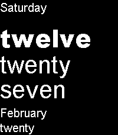

<!-- Generated by scripts/update_app_directory.py: do not edit by hand -->
[← All Pebble Developers](../developers.md)

# Teal Dulcet

*1 watchface · Last updated 2026-10-12 · [About these lists](../about-app-lists.md)*

Links: [Pebble App Store](https://apps.repebble.com/apps/dev/teal-dulcet_531f58574b9316c44f00032f) · [GitHub (tdulcet)](https://github.com/tdulcet) · [Website (tealdulcet.com)](https://tealdulcet.com/)

<h2 class="app-name" id="app-58636289e09e636615000110"><a href="https://apps.repebble.com/58636289e09e636615000110">Sliding Text++</a> v1.1.0</h2>
<a class="app-source" href="https://github.com/tdulcet/sliding-text-plus-plus" title="Source code" data-search-exclude>View source</a>

Watchface · <a href="https://forum.rebble.io/t/1114" title="Discuss this app on the Rebble forum" data-search-exclude>Forum thread</a>

Released 2016-12-28 Updated 2026-07-03

Runs on: Round 2, Time 2, Pebble 2 Duo, Pebble 2, Time Round, Time, Classic

What made Pebble’s classic Sliding Text watchface iconic is that it used words to spell the time, as opposed to numbers. Sliding Text++ additionally has the day of week, month and day fully…

