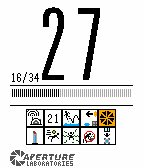

<!-- Generated by scripts/update_app_directory.py: do not edit by hand -->
[← All Pebble Developers](../developers.md)

# TeamSpen210

*1 watchface · Last updated 2026-10-11 · [About these lists](../about-app-lists.md)*

Links: [Pebble App Store](https://apps.repebble.com/apps/dev/teamspen210_52f13e16724749045200002e) · [GitHub (TeamSpen210)](https://github.com/TeamSpen210)

<h2 class="app-name" id="app-552b1f979c306bbcab000090"><a href="https://apps.repebble.com/552b1f979c306bbcab000090">Portal TC Sign</a> v2.0</h2>
<a class="app-source" href="https://github.com/TeamSpen210/PortalFace" title="Source code" data-search-exclude>View source</a>

Watchface

No licence Released 2015-04-13 Updated 2015-10-21

Runs on: Time 2, Pebble 2 Duo, Pebble 2, Time, Classic

A watchface which replicates the appearance of the Test Chamber signs in Portal 1 and 2. Plays authentic powerup animation on startup and when shaken. Vibrates when bluetooth disconnected and the…

