<!-- Generated by scripts/update_app_directory.py: do not edit by hand -->
[← All Pebble Developers](../developers.md)

# TechJeeper

*10 watchfaces and 9 apps · Last updated 2026-11-02 · [About these lists](../about-app-lists.md)*

Links: [Pebble App Store](https://apps.repebble.com/apps/dev/techjeeper_e91bf961199602727bb7cf3a) · [GitHub (TechJeeper)](https://github.com/TechJeeper)

<button type="button" data-filter="all" aria-pressed="true">All 19</button><button type="button" data-filter="watchface" aria-pressed="false">Watchfaces 10</button><button type="button" data-filter="watchapp" aria-pressed="false">Apps 9</button>

<label class="dev-sort">Sort by <select><option value="updated">Recently updated</option><option value="released">Newest release</option><option value="title">A–Z</option></select></label>

<a class="app-shot" href="https://apps.repebble.com/11e7347d2cd0465abbfbc920" data-search-exclude>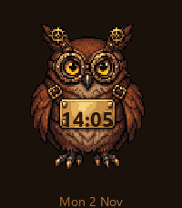</a>

<h2 class="app-name" id="app-11e7347d2cd0465abbfbc920"><a href="https://apps.repebble.com/11e7347d2cd0465abbfbc920">Steampunk Owl Face</a> v1.0.0</h2>
<a class="app-source" href="https://github.com/TechJeeper/Steampunk-Owl-Face" title="Source code" data-search-exclude>View source</a>

Watchface

No licence Released 2026-11-02 Updated 2026-11-02

Runs on: Time 2, Pebble 2 Duo, Pebble 2, Time

A clockwork owl for your wrist. Flick to blink — time stays engraved on its brass chest plate.

<a class="app-shot" href="https://apps.repebble.com/dd9782de6baa4642a55fd49a" data-search-exclude>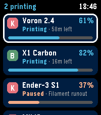</a>

<h2 class="app-name" id="app-dd9782de6baa4642a55fd49a"><a href="https://apps.repebble.com/dd9782de6baa4642a55fd49a">PrintPulse</a> v1.1.1</h2>
<a class="app-source" href="https://github.com/TechJeeper/PrintPulse" title="Source code" data-search-exclude>View source</a>

App

No licence Released 2026-10-31 Updated 2026-11-02

Runs on: Time 2, Pebble 2 Duo, Pebble 2, Time

Keep an eye on all your 3D printers from a Pebble Time 2. Add Klipper, Bambu Lab and Prusa printers from your phone, then see progress, time left, temperatures and layers at a glance, and get a…

<a class="app-shot" href="https://apps.repebble.com/763ebc02694040ee9be7d1a9" data-search-exclude>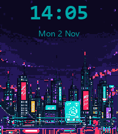</a>

<h2 class="app-name" id="app-763ebc02694040ee9be7d1a9"><a href="https://apps.repebble.com/763ebc02694040ee9be7d1a9">Neon Cityscape</a> v1.0.0</h2>
<a class="app-source" href="https://github.com/TechJeeper/Neon-Cityscape-Parallax" title="Source code" data-search-exclude>View source</a>

Watchface

No licence Released 2026-11-02 Updated 2026-11-02

Runs on: Time 2, Pebble 2 Duo, Pebble 2, Time

Cyberpunk skyline Pebble watchface — layers shift with the accelerometer for faux-3D parallax.

<a class="app-shot" href="https://apps.repebble.com/66f9941feb084eaf91747dee" data-search-exclude>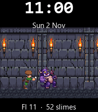</a>

<h2 class="app-name" id="app-66f9941feb084eaf91747dee"><a href="https://apps.repebble.com/66f9941feb084eaf91747dee">Dungeon Crawler Watch</a> v1.0.0</h2>
<a class="app-source" href="https://github.com/TechJeeper/Dungeon-Crawler-Watch" title="Source code" data-search-exclude>View source</a>

Watchface

No licence Released 2026-11-02 Updated 2026-11-02

Runs on: Time 2, Pebble 2 Duo, Pebble 2, Time

A tiny adventurer walks a looping dungeon corridor. Every minute they swing their sword to slay a slime; every hour they face a larger boss. Clay settings for time, HUD, speed, vibrate, and demo mode.

<a class="app-shot" href="https://apps.repebble.com/892582c32c774873909df521" data-search-exclude>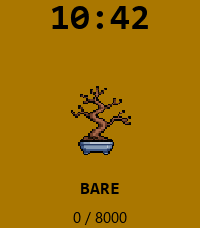</a>

<h2 class="app-name" id="app-892582c32c774873909df521"><a href="https://apps.repebble.com/892582c32c774873909df521">Bonsai Time</a> v1.0.0</h2>
<a class="app-source" href="https://github.com/TechJeeper/Bonsai-Time" title="Source code" data-search-exclude>View source</a>

Watchface

No licence Released 2026-11-02 Updated 2026-11-02

Runs on: Time 2, Time

A living pixel bonsai on your wrist. Walk, watch leaves appear, hit your goal to blossom — then at midnight it sheds and starts again.

<a class="app-shot" href="https://apps.repebble.com/9f8c91a7c0b74ffc86afb812" data-search-exclude>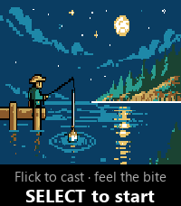</a>

<h2 class="app-name" id="app-9f8c91a7c0b74ffc86afb812"><a href="https://apps.repebble.com/9f8c91a7c0b74ffc86afb812">Wrist Cast</a> v1.1.0</h2>
<a class="app-source" href="https://github.com/TechJeeper/Wrist-Cast" title="Source code" data-search-exclude>View source</a>

App

No licence Released 2026-11-01 Updated 2026-11-01

Runs on: Time 2, Pebble 2 Duo, Pebble 2, Time

Wrist Cast is micro-fishing you play by feel. Flick your wrist to cast a line into quiet water. When something bites, the watch buzzes — press SELECT to set the hook, then work UP and DOWN to keep…

<h2 class="app-name" id="app-49c02cd9c59841feb0257a71"><a href="https://apps.repebble.com/49c02cd9c59841feb0257a71">Sonar Sub Hunt</a> v1.0.0</h2>
<a class="app-source" href="https://github.com/TechJeeper/Sonar-Sub-Hunt" title="Source code" data-search-exclude>View source</a>

App

No licence Released 2026-11-01 Updated 2026-11-01

Runs on: Time 2, Pebble 2 Duo, Pebble 2, Time

Sonar Sub Hunt turns your wrist into a sonar scope. Sweep your arm around the room — the watch uses the compass and accelerometer to aim an invisible sonar cone. Auditory pings (speaker or…

<h2 class="app-name" id="app-0c042d9ae0cc47b6a3216249"><a href="https://apps.repebble.com/0c042d9ae0cc47b6a3216249">Print Farm Simulator</a> v1.0.1</h2>
<a class="app-source" href="https://github.com/TechJeeper/Print-Farm-Simulator" title="Source code" data-search-exclude>View source</a>

App

No licence Released 2026-11-01 Updated 2026-11-01

Runs on: Time 2, Pebble 2 Duo, Pebble 2, Time

Print Farm Simulator puts a 3D printer farm on your wrist. Glance at your garage strip: printers earn money on wall-clock time even while the app is closed. When something fails, the watch vibes —…

<a class="app-shot" href="https://apps.repebble.com/4a25ab3945644e118b606a9d" data-search-exclude>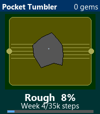</a>

<h2 class="app-name" id="app-4a25ab3945644e118b606a9d"><a href="https://apps.repebble.com/4a25ab3945644e118b606a9d">Pocket Tumbler</a> v1.0.0</h2>
<a class="app-source" href="https://github.com/TechJeeper/Pocket-Tumbler" title="Source code" data-search-exclude>View source</a>

App

No licence Released 2026-11-01 Updated 2026-11-01

Runs on: Time 2, Pebble 2 Duo, Pebble 2, Time

Pocket Tumbler is a virtual rock tumbler for your wrist. Start with a jagged gray stone in a little barrel on your Pebble. Walk in the real world — your weekly steps polish the rock. Shake the…

<a class="app-shot" href="https://apps.repebble.com/837ed79c6d9549d781d0bf23" data-search-exclude>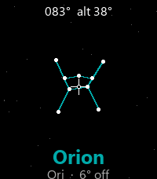</a>

<h2 class="app-name" id="app-837ed79c6d9549d781d0bf23"><a href="https://apps.repebble.com/837ed79c6d9549d781d0bf23">Pocket Star-Gazer</a> v1.1.0</h2>
<a class="app-source" href="https://github.com/TechJeeper/Pocket-Star-Gazer" title="Source code" data-search-exclude>View source</a>

App

No licence Released 2026-11-01 Updated 2026-11-01

Runs on: Time 2, Pebble 2 Duo, Pebble 2, Time

Pocket Star-Gazer turns your Pebble into a pocket planetarium viewfinder. Hold the watch face toward the stars; the compass and motion sensors figure out where you’re pointing and show the nearest…

<h2 class="app-name" id="app-df7c08fcd8594d96868d69b4"><a href="https://apps.repebble.com/df7c08fcd8594d96868d69b4">Mood Ring Face</a> v1.1.0</h2>
<a class="app-source" href="https://github.com/TechJeeper/Mood-Ring-Face" title="Source code" data-search-exclude>View source</a>

Watchface

No licence Released 2026-11-01 Updated 2026-11-01

Runs on: Time 2, Pebble 2 Duo, Pebble 2, Time

Mood Ring Face turns your wrist into a living mood ring. It reads your live heart rate and estimates stress from BPM, then shifts both the background color and an 8-bit character’s expression —…

<a class="app-shot" href="https://apps.repebble.com/5e956bb58b744f56aea1fa89" data-search-exclude>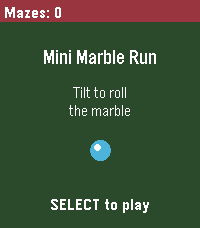</a>

<h2 class="app-name" id="app-5e956bb58b744f56aea1fa89"><a href="https://apps.repebble.com/5e956bb58b744f56aea1fa89">Mini Marble Run</a> v1.2.0</h2>
<a class="app-source" href="https://github.com/TechJeeper/mini-marble-run" title="Source code" data-search-exclude>View source</a>

App

No licence Released 2026-11-01 Updated 2026-11-01

Runs on: Time 2, Pebble 2 Duo, Pebble 2, Time

Tilt your Pebble to roll a marble through procedurally generated mazes. Clear each run, climb the difficulty, and track how many mazes you’ve finished — all on your wrist.

<a class="app-shot" href="https://apps.repebble.com/58b94ffb0c1442a3ac7df805" data-search-exclude>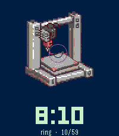</a>

<h2 class="app-name" id="app-58b94ffb0c1442a3ac7df805"><a href="https://apps.repebble.com/58b94ffb0c1442a3ac7df805">Mini 3D Printer</a> v1.1.0</h2>
<a class="app-source" href="https://github.com/TechJeeper/Mini-3D-Printer" title="Source code" data-search-exclude>View source</a>

Watchface

No licence Released 2026-11-01 Updated 2026-11-01

Runs on: Time 2, Pebble 2 Duo, Pebble 2, Time

A small 3D-looking printer on your wrist. The part on the bed gets taller through the hour, so its height shows the minutes. Each hour prints a different object, like a cube, vase, gear or rocket.

<a class="app-shot" href="https://apps.repebble.com/b81c7f8a0eab4682afeacef0" data-search-exclude>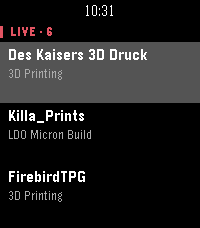</a>

<h2 class="app-name" id="app-b81c7f8a0eab4682afeacef0"><a href="https://apps.repebble.com/b81c7f8a0eab4682afeacef0">MakersOnStream</a> v1.0.2</h2>
<a class="app-source" href="https://github.com/TechJeeper/MakersOnStream-WatchApp" title="Source code" data-search-exclude>View source</a>

App

No licence Released 2026-11-01 Updated 2026-11-01

Runs on: Time 2, Pebble 2 Duo, Pebble 2, Time

MakersOnStream is a public directory and schedule for makers who stream their craft — 3D printers, woodworkers, crafters, and creators. This Pebble app puts that feed on your wrist: who’s live…

<a class="app-shot" href="https://apps.repebble.com/10b97ec7e30c45378b35eb58" data-search-exclude>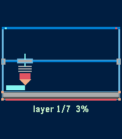</a>

<h2 class="app-name" id="app-10b97ec7e30c45378b35eb58"><a href="https://apps.repebble.com/10b97ec7e30c45378b35eb58">Layer-by-Layer</a> v1.1.2</h2>
<a class="app-source" href="https://github.com/TechJeeper/Layer-by-Layer" title="Source code" data-search-exclude>View source</a>

Watchface

No licence Released 2026-11-01 Updated 2026-11-01

Runs on: Time 2, Pebble 2 Duo, Pebble 2, Time

The digits get printed from the bottom up. A small nozzle sweeps left and right, laying down one line per pass, and when the minute changes the old digits drop off the bed and a new print starts…

<h2 class="app-name" id="app-d1c1cc4e12314b3d86512c1c"><a href="https://apps.repebble.com/d1c1cc4e12314b3d86512c1c">Layer Frenzy</a> v1.0.0</h2>
<a class="app-source" href="https://github.com/TechJeeper/Layer-Frenzy" title="Source code" data-search-exclude>View source</a>

App

No licence Released 2026-11-01 Updated 2026-11-01

Runs on: Time 2, Pebble 2 Duo, Pebble 2, Time

Layer Frenzy is a fast arcade game for makers: you are the print nozzle. A ghost outline of the target part appears on the bed — cube, pyramid, cup, vase, or boat. The nozzle sweeps each layer…

<a class="app-shot" href="https://apps.repebble.com/5dafbe88c7f84e3480aad10e" data-search-exclude>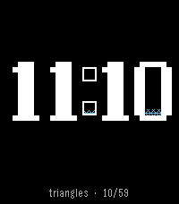</a>

<h2 class="app-name" id="app-5dafbe88c7f84e3480aad10e"><a href="https://apps.repebble.com/5dafbe88c7f84e3480aad10e">Infill Clock</a> v1.1.0</h2>
<a class="app-source" href="https://github.com/TechJeeper/Infill-Clock" title="Source code" data-search-exclude>View source</a>

Watchface

No licence Released 2026-11-01 Updated 2026-11-01

Runs on: Time 2, Pebble 2 Duo, Pebble 2, Time

The digits are drawn as solid outer walls. Inside them, an infill pattern grows as the minute passes. The pattern changes every hour (lines, honeycomb, wavy gyroid, triangles), so you can roughly…

<a class="app-shot" href="https://apps.repebble.com/1507eacaa9884132bcddf31d" data-search-exclude>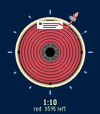</a>

<h2 class="app-name" id="app-1507eacaa9884132bcddf31d"><a href="https://apps.repebble.com/1507eacaa9884132bcddf31d">Filament Spool</a> v1.1.0</h2>
<a class="app-source" href="https://github.com/TechJeeper/Filament-Spool" title="Source code" data-search-exclude>View source</a>

Watchface

No licence Released 2026-11-01 Updated 2026-11-01

Runs on: Time 2, Pebble 2 Duo, Pebble 2, Time

An analog face built around a spool. Filament slowly unwinds through the day, so the amount left is how much day is left. The hour hand is the filament path into the extruder, and the filament…

<a class="app-shot" href="https://apps.repebble.com/9acb53f156fe4f5ea03b53c1" data-search-exclude>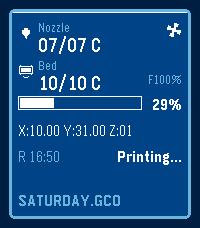</a>

<h2 class="app-name" id="app-9acb53f156fe4f5ea03b53c1"><a href="https://apps.repebble.com/9acb53f156fe4f5ea03b53c1">3D Printer LCD</a> v1.1.1</h2>
<a class="app-source" href="https://github.com/TechJeeper/3DP-LCD" title="Source code" data-search-exclude>View source</a>

Watchface

No licence Released 2026-11-01 Updated 2026-11-01

Runs on: Time 2, Pebble 2 Duo, Pebble 2, Time

A copy of the classic blue-and-white printer display. “Nozzle” temperature shows the hour, “Bed” shows the minute, the progress bar shows how much of the day has passed, and a fan icon spins in…

