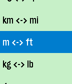

<!-- Generated by scripts/update_app_directory.py: do not edit by hand -->
[← All Pebble Developers](../developers.md)

# Technicalleigh

*1 app · Last updated 2026-10-12 · [About these lists](../about-app-lists.md)*

Links: [Pebble App Store](https://apps.repebble.com/apps/dev/technicalleigh_531a1ebc7e497544cf00037c) · [GitHub (Technicalleigh)](https://github.com/Technicalleigh)

<h2 class="app-name" id="app-564803d3b2013f752b000042"><a href="https://apps.repebble.com/564803d3b2013f752b000042">UnitVersal</a> v1.1</h2>
<a class="app-source" href="https://github.com/Technicalleigh/unitversal" title="Source code" data-search-exclude>View source</a>

App

MIT Released 2015-11-15 Updated 2015-11-15

Runs on: Round 2, Time 2, Pebble 2 Duo, Pebble 2, Time Round, Time, Classic

UnitVersal converts between common SI (metric) and US units, plus the Celsius and Fahrenheit temperature scales. Just scroll up or down. Select button: Single-click: Switch the unit whose quantity…

