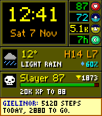

<!-- Generated by scripts/update_app_directory.py: do not edit by hand -->
[← All Pebble Developers](../developers.md)

# TechnoidAbhi

*1 watchface · Last updated 2026-11-09 · [About these lists](../about-app-lists.md)*

Links: [Pebble App Store](https://apps.repebble.com/apps/dev/technoidabhi_506ee03313d0161a36490aeb) · [GitHub (TechnoidAlpha)](https://github.com/TechnoidAlpha)

<h2 class="app-name" id="app-b23f973d0f0141e9b99f114a"><a href="https://apps.repebble.com/b23f973d0f0141e9b99f114a">Gielinor HUD</a> v26.11.2</h2>
<a class="app-source" href="https://github.com/TechnoidAlpha/gielinor-hud-pebble" title="Source code" data-search-exclude>View source</a>

Watchface

MIT Released 2026-11-02 Updated 2026-11-08

Runs on: Round 2, Time 2

Your day as an Old School RuneScape-style game screen, for the Pebble Time 2 and, new in this version, the Pebble Round 2 (beta). - Big pixel clock and date - Four status orbs: battery, heart…

