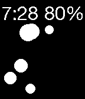

<!-- Generated by scripts/update_app_directory.py: do not edit by hand -->
[← All Pebble Developers](../developers.md)

# Ted Presley

*3 watchfaces · Last updated 2026-10-11 · [About these lists](../about-app-lists.md)*

Links: [Pebble App Store](https://apps.repebble.com/apps/dev/ted-presley_53508e68dfb1642804000077) · [GitHub (tapresle)](https://github.com/tapresle) · [Website (tapresle.github.io)](http://tapresle.github.io)

<button type="button" data-filter="all" aria-pressed="true">All 3</button><button type="button" data-filter="watchface" aria-pressed="false">Watchfaces 3</button><button type="button" data-filter="watchapp" aria-pressed="false" disabled>Apps 0</button>

<label class="dev-sort">Sort by <select><option value="updated">Recently updated</option><option value="released">Newest release</option><option value="title">A–Z</option></select></label>

<h2 class="app-name" id="app-53b34536977c65eb0d000092"><a href="https://apps.repebble.com/53b34536977c65eb0d000092">Bounce</a> v1.0.1</h2>
<a class="app-source" href="https://github.com/tapresle/Bounce" title="Source code" data-search-exclude>View source</a>

Watchface

Released 2014-07-01 Updated 2014-07-02

Runs on: Time 2, Pebble 2 Duo, Pebble 2, Time, Classic

A simple watchface built using the accelerometer demo that was posted to github a while back. Also features the helvetica neue font.

<h2 class="app-name" id="app-53554676c55d5a399e000058"><a href="https://apps.repebble.com/53554676c55d5a399e000058">SAO2</a> v1.2</h2>
<a class="app-source" href="https://github.com/tapresle/SAO2Face" title="Source code" data-search-exclude>View source</a>

Watchface

Released 2014-04-21 Updated 2014-04-25

Runs on: Time 2, Pebble 2 Duo, Pebble 2, Time, Classic

My second watch face featuring artwork from Sword Art Online. Enjoy!

<h2 class="app-name" id="app-5353b54022d5a159d3000114"><a href="https://apps.repebble.com/5353b54022d5a159d3000114">Sword Art Online Watchface</a> v1.0</h2>
<a class="app-source" href="https://github.com/tapresle/SAOFace" title="Source code" data-search-exclude>View source</a>

Watchface

Released 2014-04-20 Updated 2014-04-20

Runs on: Time 2, Pebble 2 Duo, Pebble 2, Time, Classic

Just a simple Sword Art Online watch face I made for myself and figured others would like it too. Features a small Elucidator separating the time and date!

