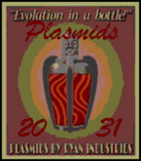

<!-- Generated by scripts/update_app_directory.py: do not edit by hand -->
[← All Pebble Developers](../developers.md)

# Teiglion

*1 watchface · Last updated 2026-10-11 · [About these lists](../about-app-lists.md)*

Links: [Rebble App Store](https://apps.rebble.io/en_US/developer/6014831d1342ae03f3d5ba26/1) · [GitLab (Teiglion)](https://gitlab.com/Teiglion)

<h2 class="app-name" id="app-6014831f1342ae03f3d5ba28"><a href="https://apps.rebble.io/en_US/application/6014831f1342ae03f3d5ba28">Bioshock Plasmids</a> v1.0</h2>
<a class="app-source" href="https://gitlab.com/Teiglion/bioshock-plasmids-watchface" title="Source code" data-search-exclude>View source</a>

Watchface

Released 2021-01-29 Updated 2021-01-29 Rebble App Store

Runs on: Round 2, Time 2, Pebble 2 Duo, Pebble 2, Time Round, Time, Classic

Shake and get a new plasmid!

