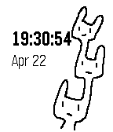

<!-- Generated by scripts/update_app_directory.py: do not edit by hand -->
[← All Pebble Developers](../developers.md)

# teshi04

*1 watchface · Last updated 2026-10-12 · [About these lists](../about-app-lists.md)*

Links: [Pebble App Store](https://apps.repebble.com/apps/dev/teshi04_56aae08e022206f841000011) · [GitHub (teshi04)](https://github.com/teshi04) · [Website (tsur.jp)](http://tsur.jp)

<h2 class="app-name" id="app-5718c9eba86f0f661200001f"><a href="https://apps.repebble.com/5718c9eba86f0f661200001f">Rabbit Tree</a> v1.1</h2>
<a class="app-source" href="https://github.com/teshi04/RabbitTree-PebbleWatchFace" title="Source code" data-search-exclude>View source</a>

Watchface

Released 2016-04-21 Updated 2016-04-22

Runs on: Round 2, Time 2, Pebble 2 Duo, Pebble 2, Time Round, Time, Classic

This is RabbitTree. Created by teshi04. RabbitTree will change facial expression depending on the time. teshi04作のウサ木(うさぎ)というキャラクターです。 時間によって表情が変わります。

