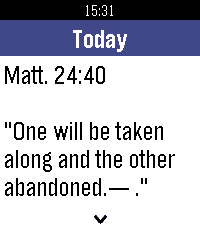

<!-- Generated by scripts/update_app_directory.py: do not edit by hand -->
[← All Pebble Developers](../developers.md)

# testarossa47

*1 app · Last updated 2026-10-11 · [About these lists](../about-app-lists.md)*

Links: [Pebble App Store](https://apps.repebble.com/apps/dev/testarossa47_6426420d77da5f9b46d1169a) · [GitHub (testarossa47)](https://github.com/testarossa47)

<h2 class="app-name" id="app-672b1221aeef4d30897a361c"><a href="https://apps.repebble.com/672b1221aeef4d30897a361c">JW Daily Text</a> v2.8.0</h2>
<a class="app-source" href="https://github.com/testarossa47/jw-daily-text" title="Source code" data-search-exclude>View source</a>

App

Released 2026-07-20 Updated 2026-09-21

Runs on: Round 2, Time 2, Pebble 2 Duo, Pebble 2, Time Round, Time, Classic

Read today&#x27;s Bible text and commentary on your Pebble. Works offline, preselects your watch language, with color UI, smooth day animations and touch scrolling.

