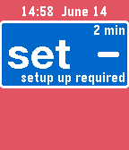
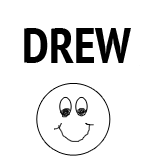
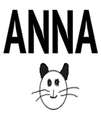

<!-- Generated by scripts/update_app_directory.py: do not edit by hand -->
[← All Pebble Developers](../developers.md)

# testyk8

*6 watchfaces · Last updated 2026-10-11 · [About these lists](../about-app-lists.md)*

Links: [Pebble App Store](https://apps.repebble.com/apps/dev/testyk8_55514ddbcf532c2c780000a6) · [GitHub (Kdisimone)](https://github.com/Kdisimone)

<button type="button" data-filter="all" aria-pressed="true">All 6</button><button type="button" data-filter="watchface" aria-pressed="false">Watchfaces 6</button><button type="button" data-filter="watchapp" aria-pressed="false" disabled>Apps 0</button>

<label class="dev-sort">Sort by <select><option value="updated">Recently updated</option><option value="released">Newest release</option><option value="title">A–Z</option></select></label>

<h2 class="app-name" id="app-565b7b11cb722e33cf0000bd"><a href="https://apps.repebble.com/565b7b11cb722e33cf0000bd">Lowcarb sky</a> v1.0</h2>
<a class="app-source" href="https://github.com/Kdisimone/PebbleSkyCgm/tree/lowcarb" title="Source code" data-search-exclude>View source</a>

Watchface

No licence Released 2015-11-29 Updated 2025-11-25

Runs on: Round 2, Time 2, Time Round, Time

This watchface modifies the CGM in the Cloud Sky watchface to allow lower &quot;high blood glucose alert levels&quot; in the settings.

<h2 class="app-name" id="app-57607b4518463b7d28000018"><a href="https://apps.repebble.com/57607b4518463b7d28000018">Vibe Spark</a> v1.0</h2>
<a class="app-source" href="https://github.com/Kdisimone/cgm-simple-spark" title="Source code" data-search-exclude>View source</a>

Watchface

No licence Released 2016-06-14 Updated 2019-07-24

Runs on: Round 2, Time 2, Pebble 2 Duo, Pebble 2, Time Round, Time, Classic

Longer vibration alerts for simple cgm

<h2 class="app-name" id="app-55961d9a70f2c35e6400000a"><a href="https://apps.repebble.com/55961d9a70f2c35e6400000a">LCHF</a> v1.2</h2>
<a class="app-source" href="https://github.com/Kdisimone/cgm-pebble.git" title="Source code" data-search-exclude>View source</a>

Watchface

No licence Released 2015-07-03 Updated 2015-08-03

Runs on: Time 2, Pebble 2 Duo, Pebble 2, Time, Classic

NS watch face customized with ability to set lower HIGH BG alert settings.

<h2 class="app-name" id="app-55a702de1f6362b73400008f"><a href="https://apps.repebble.com/55a702de1f6362b73400008f">Drew NS</a> v1.0</h2>
<a class="app-source" href="http://github.com/kdisimone/cgm-pebble" title="Source code" data-search-exclude>View source</a>

Watchface

No licence Released 2015-07-16 Updated 2015-07-16

Runs on: Time 2, Pebble 2 Duo, Pebble 2, Time, Classic

drew&#x27;s personalized NS watchface

<h2 class="app-name" id="app-55a6ad9b1f6362879b00004c"><a href="https://apps.repebble.com/55a6ad9b1f6362879b00004c">Gwen NS</a> v1.1</h2>
<a class="app-source" href="http://github.com/kdisimone/cgm-pebble" title="Source code" data-search-exclude>View source</a>

Watchface

No licence Released 2015-07-15 Updated 2015-07-15

Runs on: Time 2, Pebble 2 Duo, Pebble 2, Time, Classic

Gwyneth&#x27;s personalized NS watchface

<h2 class="app-name" id="app-55a59977ba679ad6c2000074"><a href="https://apps.repebble.com/55a59977ba679ad6c2000074">ANNA&#x27;S NS</a> v1.1</h2>
<a class="app-source" href="https://github.com/Kdisimone/cgm-pebble.git" title="Source code" data-search-exclude>View source</a>

Watchface

No licence Released 2015-07-14 Updated 2015-07-14

Runs on: Time 2, Pebble 2 Duo, Pebble 2, Time, Classic

A CUSTOMIZED WATCHFACE FOR MY T1D ANNA. DEVELOPED FROM NS CGM PEBBLE SOURCE FILES

