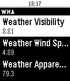

<!-- Generated by scripts/update_app_directory.py: do not edit by hand -->
[← All Pebble Developers](../developers.md)

# texnofobix

*1 app · Last updated 2026-10-11 · [About these lists](../about-app-lists.md)*

Links: [Pebble App Store](https://apps.repebble.com/apps/dev/texnofobix_56145646623d5261e7000040) · [GitHub (texnofobix)](https://github.com/texnofobix)

<h2 class="app-name" id="app-57759f9aba2fe5d0c60005b5"><a href="https://apps.repebble.com/57759f9aba2fe5d0c60005b5">Wrist Home Assistant</a> v0.6</h2>
<a class="app-source" href="https://github.com/texnofobix/WristHomeAssistant" title="Source code" data-search-exclude>View source</a>

App

Released 2016-06-30 Updated 2016-10-12

Runs on: Round 2, Time 2, Pebble 2 Duo, Pebble 2, Time Round, Time, Classic

Connects to your Home-Assistant (home-assistant.io) instance. Can control lights and switches at this time.

