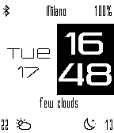
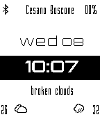

<!-- Generated by scripts/update_app_directory.py: do not edit by hand -->
[← All Pebble Developers](../developers.md)

# The Device

*2 watchfaces · Last updated 2026-10-11 · [About these lists](../about-app-lists.md)*

Links: [Pebble App Store](https://apps.repebble.com/apps/dev/the-device_5560cc3a43928b24ec0000c4) · [GitHub (sbrenna)](https://github.com/sbrenna)

<button type="button" data-filter="all" aria-pressed="true">All 2</button><button type="button" data-filter="watchface" aria-pressed="false">Watchfaces 2</button><button type="button" data-filter="watchapp" aria-pressed="false" disabled>Apps 0</button>

<label class="dev-sort">Sort by <select><option value="updated">Recently updated</option><option value="released">Newest release</option><option value="title">A–Z</option></select></label>

<h2 class="app-name" id="app-573b2ef39f6e5060de000011"><a href="https://apps.repebble.com/573b2ef39f6e5060de000011">Square Minimal</a> v1.00</h2>
<a class="app-source" href="https://github.com/sbrenna/SquareMinimal" title="Source code" data-search-exclude>View source</a>

Watchface

Released 2016-05-17 Updated 2016-05-17

Runs on: Time 2, Pebble 2 Duo, Pebble 2, Time, Classic

This watchface is a redraw of the &quot;Minimal Clean&quot; and &quot;Minimal Clean Revisited&quot;.

<h2 class="app-name" id="app-559cd56a9bd78df768000005"><a href="https://apps.repebble.com/559cd56a9bd78df768000005">Minimal Clean Revisited</a> v3.02</h2>
<a class="app-source" href="http://github.com/sbrenna/minimalclean" title="Source code" data-search-exclude>View source</a>

Watchface

No licence Released 2015-07-08 Updated 2015-10-19

Runs on: Time 2, Pebble 2 Duo, Pebble 2, Time, Classic

Inspired by &quot;Minimal Clean&quot; by Kunal Gautam (Link : pebble://appstore/557eb7fcbb3773ef7d000008). Added bluetooth status (with vibration on disconnect). Through openweathermap i&#x27;ve added: …

