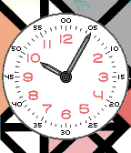
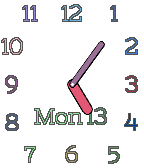
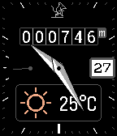
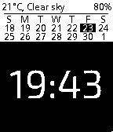
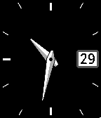
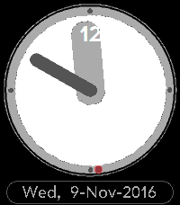
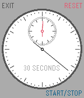
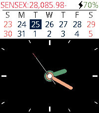
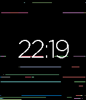

<!-- Generated by scripts/update_app_directory.py: do not edit by hand -->
[← All Pebble Developers](../developers.md)

# The Resetter

*11 watchfaces and 1 app · Last updated 2026-10-11 · [About these lists](../about-app-lists.md)*

Links: [Pebble App Store](https://apps.repebble.com/apps/dev/the-resetter_5415133bbcd1cf9264000081) · [GitHub (GreenHex)](https://github.com/GreenHex) · [Website (forums.pebble.com)](https://forums.pebble.com/t/watchface-anery-and-anery-for-pebble-time-2/)

<button type="button" data-filter="all" aria-pressed="true">All 12</button><button type="button" data-filter="watchface" aria-pressed="false">Watchfaces 11</button><button type="button" data-filter="watchapp" aria-pressed="false">Apps 1</button>

<label class="dev-sort">Sort by <select><option value="updated">Recently updated</option><option value="released">Newest release</option><option value="title">A–Z</option></select></label>

<h2 class="app-name" id="app-58a52d200dfc320dc6000330"><a href="https://apps.repebble.com/58a52d200dfc320dc6000330">HfG-MaX</a> v1.2</h2>
<a class="app-source" href="https://github.com/GreenHex/Pebble.HfG.MaX" title="Source code" data-search-exclude>View source</a>

Watchface

No licence Released 2017-02-16 Updated 2017-02-17

Runs on: Time 2, Time

A Max Bill tribute watchface.

<h2 class="app-name" id="app-5831abcb8c7fff66e10000c9"><a href="https://apps.repebble.com/5831abcb8c7fff66e10000c9">Kiddie</a> v1.28</h2>
<a class="app-source" href="https://github.com/GreenHex/Pebble.Woozy" title="Source code" data-search-exclude>View source</a>

Watchface

MIT Released 2016-11-20 Updated 2017-02-13

Runs on: Time 2, Pebble 2 Duo, Pebble 2, Time, Classic

Don&#x27;t take your eyes off the kids! Now with day and date display.

<h2 class="app-name" id="app-589a81211985caf4dd0002b7"><a href="https://apps.repebble.com/589a81211985caf4dd0002b7">Kaven</a> v1.7</h2>
<a class="app-source" href="https://github.com/GreenHex/Pebble.Kaven" title="Source code" data-search-exclude>View source</a>

Watchface

No licence Released 2017-02-08 Updated 2017-02-13

Runs on: Time 2, Time

Watchface to teach my son to tell time. &quot;Prelude&quot; typeface is from Palm webOS.

<h2 class="app-name" id="app-58988a8c6d34e335f30001f4"><a href="https://apps.repebble.com/58988a8c6d34e335f30001f4">Ulm</a> v1.1</h2>
<a class="app-source" href="https://github.com/GreenHex/Pebble.Anery.Q" title="Source code" data-search-exclude>View source</a>

Watchface

No licence Released 2017-02-06 Updated 2017-02-10

Runs on: Time 2, Pebble 2 Duo, Pebble 2, Time, Classic

Simple, elegant and easy-to-read watchface that consumes less power. This is a variation of Anery-SQ (which itself is based on the Notorious watchface).

<h2 class="app-name" id="app-585369da5de85056f0000044"><a href="https://apps.repebble.com/585369da5de85056f0000044">Anery-SQ</a> v1.9</h2>
<a class="app-source" href="https://github.com/GreenHex/Pebble.Anery.SQ" title="Source code" data-search-exclude>View source</a>

Watchface

No licence Released 2016-12-16 Updated 2017-02-06

Runs on: Time 2, Pebble 2 Duo, Pebble 2, Time, Classic

Another variation of the Anery watchface, {influenced|copied|derived} {by|from} the famous &quot;Notorious&quot; watchface by Tim Krief. Shake watch to display seconds and battery status for 8 seconds.

<h2 class="app-name" id="app-580b468353c08f2d950000b1"><a href="https://apps.repebble.com/580b468353c08f2d950000b1">Anery</a> v1.33</h2>
<a class="app-source" href="https://github.com/GreenHex/Pebble.Anery" title="Source code" data-search-exclude>View source</a>

Watchface

MIT Released 2016-10-22 Updated 2017-02-05

Runs on: Time 2, Pebble 2 Duo, Pebble 2, Time, Classic

Anery for Pebble. - Precise, easy-to-read analog watchface. - Three analog watchfaces selectable by the user. - Large date. - Hourly or half-hourly buzz. - Display seconds hand by shaking watch. …

<h2 class="app-name" id="app-57e354773095e3ed49000004"><a href="https://apps.repebble.com/57e354773095e3ed49000004">Bliss Time 2</a> v3.63</h2>
<a class="app-source" href="https://github.com/GreenHex/Pebble.BlissTime2" title="Source code" data-search-exclude>View source</a>

Watchface

MIT Released 2016-09-22 Updated 2017-01-29

Runs on: Time 2, Pebble 2 Duo, Pebble 2, Time, Classic

BLISS TIME 2 for Pebble Time. Updated version of BLISS TIME by Michael Reyes to work with SDK 4. Now includes a super precise, easy-to-read analog clock face. - Digital and analog watch faces. …

<h2 class="app-name" id="app-583cf2e1ca3094bdc0000507"><a href="https://apps.repebble.com/583cf2e1ca3094bdc0000507">Anery-</a> v1.16</h2>
<a class="app-source" href="https://github.com/GreenHex/Pebble.Anery.Minus" title="Source code" data-search-exclude>View source</a>

Watchface

MIT Released 2016-11-29 Updated 2017-01-21

Runs on: Time 2, Pebble 2 Duo, Pebble 2, Time, Classic

Lightweight version of the &quot;Anery&quot; watchface. - Easy-to-read, clean analog watchface. - Small, power-efficient code. - Supports Timeline Quick View. - Shake to display seconds hand for 5 seconds…

<h2 class="app-name" id="app-5822be1ae7785be14b000102"><a href="https://apps.repebble.com/5822be1ae7785be14b000102">webOS Clock</a> v1.5</h2>
<a class="app-source" href="https://github.com/GreenHex/Pebble.webOS.Clock" title="Source code" data-search-exclude>View source</a>

Watchface

MIT Released 2016-11-09 Updated 2017-01-15

Runs on: Time 2, Time

The much loved webOS analogue clock for your Pebble. Hour markers and date are in the webOS &quot;Prelude&quot; typeface. Shake watch for seconds display. Source is in GitHub.

<h2 class="app-name" id="app-583b006e00355aeba4000124"><a href="https://apps.repebble.com/583b006e00355aeba4000124">S5-S0-S6</a> v1.1</h2>
<a class="app-source" href="https://github.com/GreenHex/Pebble.S5-S0-S6" title="Source code" data-search-exclude>View source</a>

App

MIT Released 2016-11-27 Updated 2016-11-28

Runs on: Time 2, Pebble 2 Duo, Pebble 2, Time, Classic

Analog chronometer for the Pebble, with smooth animated seconds movement.

<h2 class="app-name" id="app-580ca87153c08f730600019f"><a href="https://apps.repebble.com/580ca87153c08f730600019f">Anery+</a> v1.2</h2>
<a class="app-source" href="https://github.com/GreenHex/Pebble.Anery.Plus" title="Source code" data-search-exclude>View source</a>

Watchface

MIT Released 2016-10-23 Updated 2016-11-02

Runs on: Time 2

Anery+ for Pebble Time 2. Anery+ is based on BLISS TIME by Michael Reyes. - Super precise, easy-to-read, analog clock face. - Digital and analog watch faces. - Display seconds in analog display by…

<h2 class="app-name" id="app-57ff6a521fd66bc99e000200"><a href="https://apps.repebble.com/57ff6a521fd66bc99e000200">Torn</a> v1.4</h2>
<a class="app-source" href="https://github.com/GreenHex/Pebble.Torn" title="Source code" data-search-exclude>View source</a>

Watchface

MIT Released 2016-10-13 Updated 2016-10-19

Runs on: Time 2, Pebble 2 Duo, Pebble 2, Time, Classic

Missing screen tearing already? v1.1 - Realistic screen tearing. - Tearing refresh represents seconds. - Better battery life than v1.0. - Supports Timeline Quick View - Supports 12 and 24 hour…

