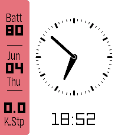

<!-- Generated by scripts/update_app_directory.py: do not edit by hand -->
[← All Pebble Developers](../developers.md)

# TheJebForge

*1 watchface · Last updated 2026-10-12 · [About these lists](../about-app-lists.md)*

Links: [Pebble App Store](https://apps.repebble.com/apps/dev/thejebforge_3188f12bb6efaec0bd907668) · [Codeberg (TheJebForge)](https://codeberg.org/TheJebForge)

<h2 class="app-name" id="app-26adea5fc6ff4dfea8b7c293"><a href="https://apps.repebble.com/26adea5fc6ff4dfea8b7c293">Complicated Analogue</a> v1.0.0</h2>
<a class="app-source" href="https://codeberg.org/TheJebForge/complicated-analogue" title="Source code" data-search-exclude>View source</a>

Watchface

Released 2026-06-04 Updated 2026-06-04

Runs on: Time 2, Pebble 2 Duo, Pebble 2, Time

Simple analogue + digital watchface with some complications

