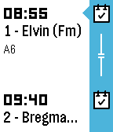
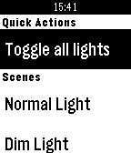

<!-- Generated by scripts/update_app_directory.py: do not edit by hand -->
[← All Pebble Developers](../developers.md)

# ThePurpleK

*2 apps · Last updated 2026-10-12 · [About these lists](../about-app-lists.md)*

Links: [Pebble App Store](https://apps.repebble.com/apps/dev/thepurplek_5606dc7f2f167dbd3d000076) · [GitHub (kz)](https://github.com/kz) · [Website (timetablepush.me)](https://timetablepush.me/)

<button type="button" data-filter="all" aria-pressed="true">All 2</button><button type="button" data-filter="watchface" aria-pressed="false" disabled>Watchfaces 0</button><button type="button" data-filter="watchapp" aria-pressed="false">Apps 2</button>

<label class="dev-sort">Sort by <select><option value="updated">Recently updated</option><option value="released">Newest release</option><option value="title">A–Z</option></select></label>

<h2 class="app-name" id="app-562a89497480835e51000090"><a href="https://apps.repebble.com/562a89497480835e51000090">Timetable Pusher</a> v2.0</h2>
<a class="app-source" href="https://github.com/kz/timetable-pusher-pebble" title="Source code" data-search-exclude>View source</a>

App

Released 2015-10-23 Updated 2018-06-14

Runs on: Round 2, Time 2, Pebble 2 Duo, Pebble 2, Time Round, Time, Classic

Push your class timetable to your timeline with Timetable Pusher. Simply visit https://timetablepush.me/, enter your timetables, install the app and get started! Questions? Reach out to me at…

<h2 class="app-name" id="app-562cfbeab56e5de360000091"><a href="https://apps.repebble.com/562cfbeab56e5de360000091">Remote for LIFX</a> v1.2</h2>
<a class="app-source" href="https://github.com/kz/lifx-pebble-app" title="Source code" data-search-exclude>View source</a>

App

Released 2015-10-25 Updated 2016-10-02

Runs on: Round 2, Time 2, Pebble 2 Duo, Pebble 2, Time Round, Time, Classic

Toggle your LIFX lights and activate your scenes using Remote for LIFX. Suggestions? Bugs? Feel free to get in touch! Disclaimer: Remote for LIFX is an unofficial app and is not affiliated with…

