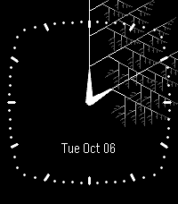

<!-- Generated by scripts/update_app_directory.py: do not edit by hand -->
[← All Pebble Developers](../developers.md)

# thevgm

*1 watchface · Last updated 2026-10-11 · [About these lists](../about-app-lists.md)*

Links: [Pebble App Store](https://apps.repebble.com/apps/dev/thevgm_d9cc14a5a086ce77dc88cf71) · [GitHub (Thevgm01)](https://github.com/Thevgm01)

<h2 class="app-name" id="app-c2a585819b05410b9be85998"><a href="https://apps.repebble.com/c2a585819b05410b9be85998">Analog Fractal</a> v1.0.1</h2>
<a class="app-source" href="https://github.com/Thevgm01/PebbleFractal" title="Source code" data-search-exclude>View source</a>

Watchface

No licence Released 2026-10-07 Updated 2026-10-07

Runs on: Round 2, Time 2, Time Round, Time

Enjoy recursive artwork created from the angle of the minute and hour hands at that moment! Contains many settings, including customizable colors, variable lengths and recursion factor, different…

