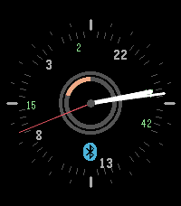

<!-- Generated by scripts/update_app_directory.py: do not edit by hand -->
[← All Pebble Developers](../developers.md)

# TheYoung

*1 watchface · Last updated 2026-10-12 · [About these lists](../about-app-lists.md)*

Links: [Pebble App Store](https://apps.repebble.com/apps/dev/theyoung_1be61dccc9848d8be9f4a808) · [GitLab (glejeune)](https://gitlab.com/glejeune)

<h2 class="app-name" id="app-185fd3518b98492a957c25d7"><a href="https://apps.repebble.com/185fd3518b98492a957c25d7">elbbep</a> v1.0</h2>
<a class="app-source" href="https://gitlab.com/glejeune/elbbep" title="Source code" data-search-exclude>View source</a>

Watchface · <a href="https://forum.rebble.io/t/857" title="Discuss this app on the Rebble forum" data-search-exclude>Forum thread</a>

Released 2026-04-12 Updated 2026-04-12

Runs on: Round 2, Time 2, Pebble 2 Duo, Pebble 2, Time Round, Time, Classic

A clean analog watchface with a 24-hour dial running anti-clockwise.

