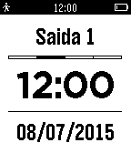

<!-- Generated by scripts/update_app_directory.py: do not edit by hand -->
[← All Pebble Developers](../developers.md)

# Thiago Salles

*1 app · Last updated 2026-10-11 · [About these lists](../about-app-lists.md)*

Links: [Pebble App Store](https://apps.repebble.com/apps/dev/thiago-salles_559166e40c3212d7b500005d) · [GitHub (thiagosalles)](https://github.com/thiagosalles) · [Website (meu-ponto.appspot.com)](http://meu-ponto.appspot.com/)

<h2 class="app-name" id="app-559d3dc9d106c8c6af000034"><a href="https://apps.repebble.com/559d3dc9d106c8c6af000034">Meu Ponto</a> v1.1</h2>
<a class="app-source" href="https://github.com/thiagosalles/meu_ponto_pebble/" title="Source code" data-search-exclude>View source</a>

App

Released 2015-07-08 Updated 2015-07-09

Runs on: Time 2, Pebble 2 Duo, Pebble 2, Time, Classic

Meu Ponto é um aplicativo para controlar os seus horários de entrada e saída do trabalho e saldo total de horas. Meu Ponto para o Pebble permite que você registre os horários na sua conta do Meu…

