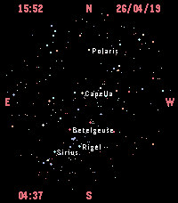

<!-- Generated by scripts/update_app_directory.py: do not edit by hand -->
[← All Pebble Developers](../developers.md)

# Thimoteus

*1 watchface · Last updated 2026-10-11 · [About these lists](../about-app-lists.md)*

Links: [Pebble App Store](https://apps.repebble.com/apps/dev/thimoteus_e1a874df2b9d5bc078a1ba78) · [GitHub (Thimoteus)](https://github.com/Thimoteus)

<h2 class="app-name" id="app-58e00e34ca124034bcb4acca"><a href="https://apps.repebble.com/58e00e34ca124034bcb4acca">astroface</a> v1.1</h2>
<a class="app-source" href="https://github.com/Thimoteus/astroface" title="Source code" data-search-exclude>View source</a>

Watchface

No licence Released 2026-04-19 Updated 2026-04-19

Runs on: Time 2

A watchface for the PT2 that displays local time, date, and apparent sidereal time, as well as a starfield of what is above the observer&#x27;s head at the current moment.

