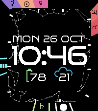

<!-- Generated by scripts/update_app_directory.py: do not edit by hand -->
[← All Pebble Developers](../developers.md)

# Thinkswift

*1 watchface · Last updated 2026-10-26 · [About these lists](../about-app-lists.md)*

Links: [Rebble App Store](https://apps.rebble.io/en_US/developer/6adee848b9bd2a0008320f54/1) · [GitHub (geoff-ts)](https://github.com/geoff-ts) · [Website (thinkswift.au)](https://thinkswift.au)

<h2 class="app-name" id="app-6adeea93c55c4f0009973312"><a href="https://apps.rebble.io/en_US/application/6adeea93c55c4f0009973312">Nadir</a> v1.0.0</h2>
<a class="app-source" href="https://github.com/geoff-ts/nadir" title="Source code" data-search-exclude>View source</a>

Watchface · <a href="https://forum.rebble.io/t/1462" title="Discuss this app on the Rebble forum" data-search-exclude>Forum thread</a>

MIT Released 2026-10-26 Updated 2026-10-26 Rebble App Store

Runs on: Time 2

A Pebble Time 2 watchface that shows where the Sun, Moon, planets and space stations are in your sky right now, around the time, date and two readouts of your choice. Nadir by day: the Sun…

