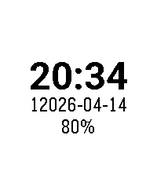
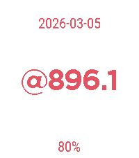

<!-- Generated by scripts/update_app_directory.py: do not edit by hand -->
[← All Pebble Developers](../developers.md)

# Thomas Cherry

*2 watchfaces and 2 apps · Last updated 2026-10-12 · [About these lists](../about-app-lists.md)*

Links: [Pebble App Store](https://apps.repebble.com/apps/dev/thomas-cherry_e17c5c02c0004112d037771d) · [GitHub (jceaser)](https://github.com/jceaser)

<button type="button" data-filter="all" aria-pressed="true">All 4</button><button type="button" data-filter="watchface" aria-pressed="false">Watchfaces 2</button><button type="button" data-filter="watchapp" aria-pressed="false">Apps 2</button>

<label class="dev-sort">Sort by <select><option value="updated">Recently updated</option><option value="released">Newest release</option><option value="title">A–Z</option></select></label>

<h2 class="app-name" id="app-3023af58454c4d53b96def0a"><a href="https://apps.repebble.com/3023af58454c4d53b96def0a">The Real Time</a> v0.1</h2>
<a class="app-source" href="https://github.com/jceaser/pebble-real-time" title="Source code" data-search-exclude>View source</a>

Watchface

No licence Released 2026-04-26 Updated 2026-04-26

Runs on: Round 2, Time 2, Pebble 2 Duo, Pebble 2, Time Round, Time, Classic

The Government does not want you to know what time it is, they want you living in a world created by them, a world where they claim they can change the rotation of the Earth. Not any more people…

<h2 class="app-name" id="app-e06a6b84092b469390bd6d6d"><a href="https://apps.repebble.com/e06a6b84092b469390bd6d6d">25 Hour Day</a> v0.1</h2>
<a class="app-source" href="https://github.com/jceaser/pebble-hour25" title="Source code" data-search-exclude>View source</a>

Watchface

No licence Released 2026-04-15 Updated 2026-04-15

Runs on: Round 2, Time 2, Pebble 2 Duo, Pebble 2, Time Round, Time

Need more time? Tired of other watches shorting your day? Try our 25 Hour Watch, now with an extra hour! Get more done, have more personal time, enjoy life for once! With our patented time…

<h2 class="app-name" id="app-b3a9a279975041c8b078eaef"><a href="https://apps.repebble.com/b3a9a279975041c8b078eaef">Edo Clock</a> v0.1</h2>
<a class="app-source" href="https://github.com/jceaser/pebble-edo" title="Source code" data-search-exclude>View source</a>

App

No licence Released 2026-04-13 Updated 2026-04-13

Runs on: Round 2, Time 2, Pebble 2 Duo, Pebble 2, Time Round, Time

This app is an Edo Clock. Edo period clocks are based on 6 hours spaced from sun rise to sun set. Summer hours are longer then winter hours.

<h2 class="app-name" id="app-177f26f0ace84ea9bdb29a99"><a href="https://apps.repebble.com/177f26f0ace84ea9bdb29a99">@beat</a> v0.1.1</h2>
<a class="app-source" href="https://github.com/jceaser/pebble-beat/" title="Source code" data-search-exclude>View source</a>

App

No licence Released 2026-04-05 Updated 2026-04-05

Runs on: Round 2, Time 2, Pebble 2 Duo, Pebble 2, Time Round, Time

Initial release of an old Pebble app that I never got around to publishing when Pebble was now, but now that we are here for round 2 I&#x27;m inspired to share what I have. Very basic implementation of…

