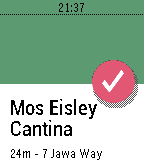

<!-- Generated by scripts/update_app_directory.py: do not edit by hand -->
[← All Pebble Developers](../developers.md)

# Thomas Hunsaker

*1 app · Last updated 2026-10-11 · [About these lists](../about-app-lists.md)*

Links: [Pebble App Store](https://apps.repebble.com/apps/dev/thomas-hunsaker_52b20405b70e1cd469000037) · [GitHub (thunsaker)](https://github.com/thunsaker) · [Website (thunsaker.github.io)](http://thunsaker.github.io/spoon/)

<h2 class="app-name" id="app-52b2088505c0467ea900004f"><a href="https://apps.repebble.com/52b2088505c0467ea900004f">Spoon</a> v3.3</h2>
<a class="app-source" href="https://github.com/thunsaker/spoon" title="Source code" data-search-exclude>View source</a>

App

Released 2013-12-18 Updated 2019-07-24

Runs on: Round 2, Time 2, Pebble 2 Duo, Pebble 2, Time Round, Time

Spoon is a simple Foursquare/Swarm check-in app for Pebble. The watchapp lists nearby venues using your phone&#x27;s GPS location. Pick a venue and check-in. All from your wrist. Español Spoon es un…

