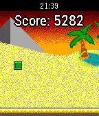

<!-- Generated by scripts/update_app_directory.py: do not edit by hand -->
[← All Pebble Developers](../developers.md)

# Thomas Neff

*1 app · Last updated 2026-10-12 · [About these lists](../about-app-lists.md)*

Links: [Pebble App Store](https://apps.repebble.com/apps/dev/thomas-neff_5544f855e6287133b0000069) · [GitHub (thomasneff)](https://github.com/thomasneff)

<h2 class="app-name" id="app-554f9adb4e604b9ed3000071"><a href="https://apps.repebble.com/554f9adb4e604b9ed3000071">Greeney&#x27;s Run</a> v1.88</h2>
<a class="app-source" href="https://github.com/thomasneff/GreeneysRun" title="Source code" data-search-exclude>View source</a>

App

Released 2015-05-10 Updated 2019-07-24

Runs on: Round 2, Time 2, Pebble 2 Duo, Pebble 2, Time Round, Time, Classic

Greeney&#x27;s Run is a procedurally generated endless running game, which is perfect for short amounts of time. Jump and run your way through segments of increasing difficulty and try to survive as…

