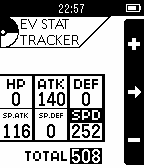

<!-- Generated by scripts/update_app_directory.py: do not edit by hand -->
[← All Pebble Developers](../developers.md)

# Thomas Neptune

*1 watchface and 1 app · Last updated 2026-10-11 · [About these lists](../about-app-lists.md)*

Links: [Pebble App Store](https://apps.repebble.com/apps/dev/thomas-neptune_559e2b65479e456928000008) · [GitHub (CTNeptune)](https://github.com/CTNeptune)

<button type="button" data-filter="all" aria-pressed="true">All 2</button><button type="button" data-filter="watchface" aria-pressed="false">Watchfaces 1</button><button type="button" data-filter="watchapp" aria-pressed="false">Apps 1</button>

<label class="dev-sort">Sort by <select><option value="updated">Recently updated</option><option value="released">Newest release</option><option value="title">A–Z</option></select></label>

<h2 class="app-name" id="app-55d126a38e4ef54ef0000059"><a href="https://apps.repebble.com/55d126a38e4ef54ef0000059">Mr Robot</a> v1.1</h2>
<a class="app-source" href="https://github.com/CTNeptune/Mr-Robot-Watchface" title="Source code" data-search-exclude>View source</a>

Watchface

No licence Released 2015-08-17 Updated 2015-08-19

Runs on: Time 2, Time

A Mr Robot watchface. Shows time, date, and day.

<h2 class="app-name" id="app-55b847c0d584f7a879000011"><a href="https://apps.repebble.com/55b847c0d584f7a879000011">Pokemon EV Counter / Tracker</a> v1.0</h2>
<a class="app-source" href="https://github.com/CTNeptune/PebbleEVStatTracker/" title="Source code" data-search-exclude>View source</a>

App

No licence Released 2015-07-29 Updated 2015-07-29

Runs on: Time 2, Pebble 2 Duo, Pebble 2, Time, Classic

This is an app for both Pebble and Pebble Time devices that keeps track of how many EV (Effort Values) your pokemon has. Useful for competitive pokemon players, your pokemon&#x27;s EVs are now just a…

