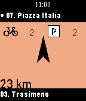
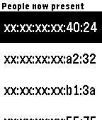

<!-- Generated by scripts/update_app_directory.py: do not edit by hand -->
[← All Pebble Developers](../developers.md)

# Thomas Perale

*2 apps · Last updated 2026-10-12 · [About these lists](../about-app-lists.md)*

Links: [Pebble App Store](https://apps.repebble.com/apps/dev/thomas-perale_5672e766542be03aeb000038) · [GitHub (thomacer)](https://github.com/thomacer)

<button type="button" data-filter="all" aria-pressed="true">All 2</button><button type="button" data-filter="watchface" aria-pressed="false" disabled>Watchfaces 0</button><button type="button" data-filter="watchapp" aria-pressed="false">Apps 2</button>

<label class="dev-sort">Sort by <select><option value="updated">Recently updated</option><option value="released">Newest release</option><option value="title">A–Z</option></select></label>

<h2 class="app-name" id="app-5712b0e918b16185ee000020"><a href="https://apps.repebble.com/5712b0e918b16185ee000020">Open Bike Sharing</a> v2.4</h2>
<a class="app-source" href="https://github.com/thomacer/pebble-villo" title="Source code" data-search-exclude>View source</a>

App

Released 2016-04-16 Updated 2016-08-13

Runs on: Round 2, Time 2, Pebble 2 Duo, Pebble 2, Time Round, Time, Classic

Use your local bike sharing system with Open Bike Sharing to find the closest station according to your position. Open Bike Sharing use an easy to use design to look after stations in a glance…

<h2 class="app-name" id="app-57a269a31482cdecc7000203"><a href="https://apps.repebble.com/57a269a31482cdecc7000203">Hackerspace</a> v1.1</h2>
<a class="app-source" href="https://github.com/thomacer/pebble-hackerspace" title="Source code" data-search-exclude>View source</a>

App

Released 2016-08-03 Updated 2016-08-03

Runs on: Round 2, Time 2, Pebble 2 Duo, Pebble 2, Time Round, Time, Classic

&quot;Hackerspace&quot; is the application to use with your local hackerspace or smart home spaceAPI. It give you on your wrist all the information from a spaceAPI so you can check them in a glance. The…

