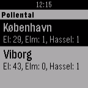
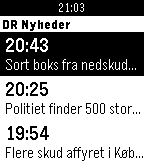

<!-- Generated by scripts/update_app_directory.py: do not edit by hand -->
[← All Pebble Developers](../developers.md)

# Thomas Piil Rosted

*2 apps · Last updated 2026-10-12 · [About these lists](../about-app-lists.md)*

Links: [Pebble App Store](https://apps.repebble.com/apps/dev/thomas-piil-rosted_5650248844a2b654d0000038) · [GitHub (thomasrosted)](https://github.com/thomasrosted)

<button type="button" data-filter="all" aria-pressed="true">All 2</button><button type="button" data-filter="watchface" aria-pressed="false" disabled>Watchfaces 0</button><button type="button" data-filter="watchapp" aria-pressed="false">Apps 2</button>

<label class="dev-sort">Sort by <select><option value="updated">Recently updated</option><option value="released">Newest release</option><option value="title">A–Z</option></select></label>

<h2 class="app-name" id="app-56f269f81fd1e7abbf000040"><a href="https://apps.repebble.com/56f269f81fd1e7abbf000040">Pollental</a> v1.1</h2>
<a class="app-source" href="https://github.com/thomasrosted/PebblePollental" title="Source code" data-search-exclude>View source</a>

App

Released 2016-03-23 Updated 2016-03-24

Runs on: Time 2, Pebble 2 Duo, Pebble 2, Time, Classic

Daily danish pollen counts (pollental) provided by Danmarks Meteorologiske Institut.

<h2 class="app-name" id="app-567468a0a81715e9a0000048"><a href="https://apps.repebble.com/567468a0a81715e9a0000048">DR Nyheder</a> v1.1</h2>
<a class="app-source" href="https://github.com/thomasrosted/PebbleDRNyheder" title="Source code" data-search-exclude>View source</a>

App

Released 2015-12-18 Updated 2015-12-21

Runs on: Time 2, Pebble 2 Duo, Pebble 2, Time, Classic

Latest news from DR Nyheder in danish.

