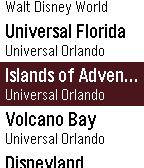
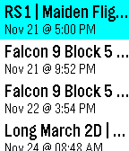
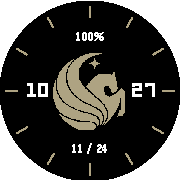
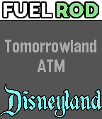
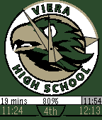
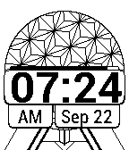

<!-- Generated by scripts/update_app_directory.py: do not edit by hand -->
[← All Pebble Developers](../developers.md)

# Thomas Stoeckert

*3 watchfaces and 3 apps · Last updated 2026-10-12 · [About these lists](../about-app-lists.md)*

Links: [Pebble App Store](https://apps.repebble.com/apps/dev/thomas-stoeckert_55e827430a081ae5f9000009) · [Rebble App Store](https://apps.rebble.io/en_US/developer/55e827430a081ae5f9000009/1) · [GitHub (thomasstoeckert)](https://github.com/thomasstoeckert) · [Website (thomasstoeckert.us)](https://thomasstoeckert.us/projects/pebble-wait-times)

<button type="button" data-filter="all" aria-pressed="true">All 6</button><button type="button" data-filter="watchface" aria-pressed="false">Watchfaces 3</button><button type="button" data-filter="watchapp" aria-pressed="false">Apps 3</button>

<label class="dev-sort">Sort by <select><option value="updated">Recently updated</option><option value="released">Newest release</option><option value="title">A–Z</option></select></label>

<h2 class="app-name" id="app-60cdd1811342ae86c897beab"><a href="https://apps.repebble.com/60cdd1811342ae86c897beab">Wait Times</a> v4.0</h2>
<a class="app-source" href="https://github.com/thomasstoeckert/waittimes" title="Source code" data-search-exclude>View source</a>

App

Released 2021-06-19 Updated 2025-09-07

Runs on: Round 2, Time 2, Pebble 2 Duo, Pebble 2, Time Round, Time, Classic

A pebble watchapp to conveniently organize the live wait-time information for attractions at various theme parks around the world - including those at Walt Disney World, Universal Orlando Resort…

<h2 class="app-name" id="app-637a4c21fdf3e30009f6395d"><a href="https://apps.repebble.com/637a4c21fdf3e30009f6395d">Perihelion</a> v1.0</h2>
<a class="app-source" href="https://github.com/thomasstoeckert/local-launch-library" title="Source code" data-search-exclude>View source</a>

App

Released 2022-11-20 Updated 2022-11-20

Runs on: Round 2, Time 2, Pebble 2 Duo, Pebble 2, Time Round, Time, Classic

This app displays the names, dates, and times of the next 10 rocket launches from around the world, using data provided by LaunchLibrary. Made as part of the first Rebble Hackathon

<h2 class="app-name" id="app-5a183f5a0dfc323bd000344e"><a href="https://apps.rebble.io/en_US/application/5a183f5a0dfc323bd000344e">KnightsFace</a> v1.1</h2>
<a class="app-source" href="https://github.com/thomasstoeckert/KnightsFace" title="Source code" data-search-exclude>View source</a>

Watchface

Released 2017-11-24 Updated 2017-11-26 Rebble App Store

Runs on: Round 2, Time Round

Show your Knight Pride with this watchface, with both analog and digital time display. It also has several different icons to fit your mood.

<h2 class="app-name" id="app-5939fe5d0dfc32af610003df"><a href="https://apps.repebble.com/5939fe5d0dfc32af610003df">Disney Parks Fuel Rod Locator</a> v2.0</h2>
<a class="app-source" href="https://github.com/thomasstoeckert/fuelRodLocator" title="Source code" data-search-exclude>View source</a>

App

Released 2017-06-09 Updated 2017-06-30

Runs on: Round 2, Time 2, Pebble 2 Duo, Pebble 2, Time Round, Time, Classic

This app lets you find Fuel Rod rechargeable battery swap kiosks at any Disney park in North America. Pressing select will toggle between Walt Disney World locations and Disneyland locations…

<h2 class="app-name" id="app-5611916f9af990f8ce00002f"><a href="https://apps.repebble.com/5611916f9af990f8ce00002f">VHS Watchface</a> v1.7</h2>
<a class="app-source" href="https://github.com/thomasstoeckert/vhsface" title="Source code" data-search-exclude>View source</a>

Watchface

Released 2015-10-04 Updated 2015-11-24

Runs on: Time 2, Pebble 2 Duo, Pebble 2, Time, Classic

An analog watchface made for Viera High School. Has the 2015-2016 school clock schedule, including short schedules for wednesdays. Features: - Analog and digital display - Time remaining in…

<h2 class="app-name" id="app-55ff1b8f4d083dbfea0000a0"><a href="https://apps.repebble.com/55ff1b8f4d083dbfea0000a0">Spaceship Earth</a> v1.50</h2>
<a class="app-source" href="https://github.com/thomasstoeckert/spaceshipearth" title="Source code" data-search-exclude>View source</a>

Watchface

Released 2015-09-20 Updated 2015-09-28

Runs on: Time 2, Pebble 2 Duo, Pebble 2, Time, Classic

My first watchface, inspired by the spaceship earth globe found in Epcot in Disney World. Features: - Time, formatted for both 12 and 24 hours - PM/AM icon and label - Battery level bar - Animated…

