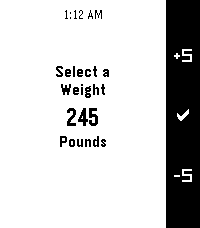
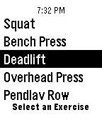

<!-- Generated by scripts/update_app_directory.py: do not edit by hand -->
[← All Pebble Developers](../developers.md)

# thomasfiveash

*2 apps · Last updated 2026-10-12 · [About these lists](../about-app-lists.md)*

Links: [Rebble App Store](https://apps.rebble.io/en_US/developer/56f74c2ee5887934b7000022/1) · [Pebble App Store](https://apps.repebble.com/apps/dev/thomasfiveash_56f74c2ee5887934b7000022) · [GitHub (t0mf)](https://github.com/t0mf) · [GitHub (thomasfiveash)](https://github.com/thomasfiveash)

<button type="button" data-filter="all" aria-pressed="true">All 2</button><button type="button" data-filter="watchface" aria-pressed="false" disabled>Watchfaces 0</button><button type="button" data-filter="watchapp" aria-pressed="false">Apps 2</button>

<label class="dev-sort">Sort by <select><option value="updated">Recently updated</option><option value="released">Newest release</option><option value="title">A–Z</option></select></label>

<h2 class="app-name" id="app-58b3588e0dfc32a52a00016a"><a href="https://apps.rebble.io/en_US/application/58b3588e0dfc32a52a00016a">Warmup Sets 2</a> v1.3</h2>
<a class="app-source" href="https://github.com/t0mf/PebbleWarmupSetsV2" title="Source code" data-search-exclude>View source</a>

App

Released 2017-02-26 Updated 2021-12-05 Rebble App Store

Runs on: Round 2, Time 2, Pebble 2 Duo, Pebble 2, Time Round, Time, Classic

Warmup Sets 2 is the watch app to have while you&#x27;re in the gym! The goal is to help you determine the sets you should do for your warmup while also providing you with barbell plate math and other…

<h2 class="app-name" id="app-573273836dfc301c9d000002"><a href="https://apps.repebble.com/573273836dfc301c9d000002">Warmup Sets</a> v2.0</h2>
<a class="app-source" href="https://github.com/thomasfiveash/PebbleWarmupSets" title="Source code" data-search-exclude>View source</a>

App

Released 2016-05-10 Updated 2021-12-05

Runs on: Round 2, Time 2, Pebble 2 Duo, Pebble 2, Time Round, Time, Classic

**New Feature** With the release of 2.0 I have added the ability to specify the warmup set multipliers! This means that for each exercise you can say exactly what percentage of the max weight you…

