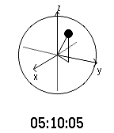

<!-- Generated by scripts/update_app_directory.py: do not edit by hand -->
[← All Pebble Developers](../developers.md)

# thyung

*2 watchfaces · Last updated 2026-10-11 · [About these lists](../about-app-lists.md)*

Links: [Pebble App Store](https://apps.repebble.com/apps/dev/thyung_531bed0cc5f2c58d3f000a52) · [GitHub (thyung)](https://github.com/thyung)

<button type="button" data-filter="all" aria-pressed="true">All 2</button><button type="button" data-filter="watchface" aria-pressed="false">Watchfaces 2</button><button type="button" data-filter="watchapp" aria-pressed="false" disabled>Apps 0</button>

<label class="dev-sort">Sort by <select><option value="updated">Recently updated</option><option value="released">Newest release</option><option value="title">A–Z</option></select></label>

<h2 class="app-name" id="app-6379e44cc6c24a000a815e83"><a href="https://apps.repebble.com/6379e44cc6c24a000a815e83">Bloch Sphere</a> v1.0</h2>
<a class="app-source" href="https://github.com/thyung/bloch-sphere" title="Source code" data-search-exclude>View source</a>

Watchface

Released 2022-11-20 Updated 2022-11-20

Runs on: Round 2, Time 2, Pebble 2 Duo, Pebble 2, Time Round, Time, Classic

Present time in Bloch Sphere. Hour and minute are mapped to theta and phi. Second is mapped to the view angle. Actual time is showed for reference.

<h2 class="app-name" id="app-53f781ad94e7d303cb000266"><a href="https://apps.repebble.com/53f781ad94e7d303cb000266">Gravity</a> v1.00</h2>
<a class="app-source" href="https://github.com/thyung/PebbleFace_gravity" title="Source code" data-search-exclude>View source</a>

Watchface

Released 2014-08-22 Updated 2014-08-22

Runs on: Time 2, Pebble 2 Duo, Pebble 2, Time, Classic

Rotate the time display with gravity

