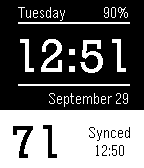

<!-- Generated by scripts/update_app_directory.py: do not edit by hand -->
[← All Pebble Developers](../developers.md)

# Tim Dayley

*1 watchface · Last updated 2026-10-11 · [About these lists](../about-app-lists.md)*

Links: [Pebble App Store](https://apps.repebble.com/apps/dev/tim-dayley_549b929963c11ae1250000cf) · [GitHub (tdayley)](https://github.com/tdayley) · [Website (timdayley.com)](http://www.timdayley.com)

<h2 class="app-name" id="app-55ac922477eb5ef7ab000048"><a href="https://apps.repebble.com/55ac922477eb5ef7ab000048">Simple Time, Date, and Weather</a> v1.3</h2>
<a class="app-source" href="https://github.com/tdayley/Pebble" title="Source code" data-search-exclude>View source</a>

Watchface

Released 2015-07-20 Updated 2016-04-26

Runs on: Time 2, Pebble 2 Duo, Pebble 2, Time, Classic

Simple time, date, and weather watchface that syncs the temperature every 5 minutes.

