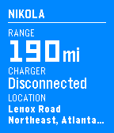

<!-- Generated by scripts/update_app_directory.py: do not edit by hand -->
[← All Pebble Developers](../developers.md)

# Tim Dorr

*1 app · Last updated 2026-10-12 · [About these lists](../about-app-lists.md)*

Links: [Pebble App Store](https://apps.repebble.com/apps/dev/tim-dorr_54ef8788565f03ae8e0000ba) · [GitHub (timdorr)](https://github.com/timdorr)

<h2 class="app-name" id="app-559d32659bd78d3bc1000032"><a href="https://apps.repebble.com/559d32659bd78d3bc1000032">Tesla Time</a> v0.5</h2>
<a class="app-source" href="https://github.com/timdorr/tesla-time" title="Source code" data-search-exclude>View source</a>

App

Released 2015-07-08 Updated 2017-05-26

Runs on: Time 2, Pebble 2 Duo, Pebble 2, Time, Classic

Monitor and control your Tesla Model S from your wrist. **IMPORTANT** Make sure you visit the settings from your Pebble or Pebble Time app first. The app won&#x27;t work without it! - Check your range…

