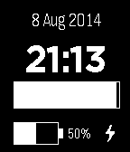

<!-- Generated by scripts/update_app_directory.py: do not edit by hand -->
[← All Pebble Developers](../developers.md)

# Tim Emanuel

*1 watchface · Last updated 2026-10-11 · [About these lists](../about-app-lists.md)*

Links: [Pebble App Store](https://apps.repebble.com/apps/dev/tim-emanuel_53d97b9f8ace930a620001ad)

<h2 class="app-name" id="app-53e53089ca9f07e53c000166"><a href="https://apps.repebble.com/53e53089ca9f07e53c000166">Second Progress</a> v1.0.0</h2>
<a class="app-source" href="https://drive.google.com/file/d/0B8uA5rnPu1hmNnZYOFdqbkExaG8/edit?usp=sharing" title="Source code" data-search-exclude>View source</a>

Watchface

Released 2014-08-08 Updated 2014-08-08

Runs on: Time 2, Pebble 2 Duo, Pebble 2, Time, Classic

A simple face I did just to learn development, but it works so I thought I&#x27;d make it available. It&#x27;s got date, time, a progress bar for seconds, battery level and a lightning bolt when charging…

