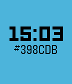

<!-- Generated by scripts/update_app_directory.py: do not edit by hand -->
[← All Pebble Developers](../developers.md)

# Tim the Guy

*1 watchface · Last updated 2026-10-12 · [About these lists](../about-app-lists.md)*

Links: [Pebble App Store](https://apps.repebble.com/apps/dev/tim-the-guy_53062ff921336c2d470002de) · [GitHub (timtheguy)](https://github.com/timtheguy) · [Website (timtheguy.com)](http://www.timtheguy.com)

<h2 class="app-name" id="app-57daef49ac56ea936d0000d6"><a href="https://apps.repebble.com/57daef49ac56ea936d0000d6">Color Ticker</a> v1.3</h2>
<a class="app-source" href="https://github.com/timtheguy/color-picker" title="Source code" data-search-exclude>View source</a>

Watchface

Released 2016-09-15 Updated 2016-10-26

Runs on: Round 2, Time 2, Time Round, Time

Color Ticker (a play on &#x27;color picker&#x27;) is the most straight-forward hex-color watchface designed by a web developer, for web developers. Every minute, a random hex color will be generated and the…

