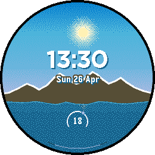
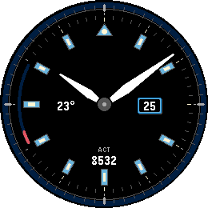

<!-- Generated by scripts/update_app_directory.py: do not edit by hand -->
[← All Pebble Developers](../developers.md)

# TimeCtrl

*2 watchfaces · Last updated 2026-10-12 · [About these lists](../about-app-lists.md)*

Links: [Pebble App Store](https://apps.repebble.com/apps/dev/timectrl_cbfbe38addd006b1222c5679)

<button type="button" data-filter="all" aria-pressed="true">All 2</button><button type="button" data-filter="watchface" aria-pressed="false">Watchfaces 2</button><button type="button" data-filter="watchapp" aria-pressed="false" disabled>Apps 0</button>

<label class="dev-sort">Sort by <select><option value="updated">Recently updated</option><option value="released">Newest release</option><option value="title">A–Z</option></select></label>

<h2 class="app-name" id="app-0256c72e7ee746eb900679e7"><a href="https://apps.repebble.com/0256c72e7ee746eb900679e7">Horizons</a> v2.0</h2>
<a class="app-source" href="https://pebble-site-ivory.vercel.app/index.html" title="Source code" data-search-exclude>View source</a>

Watchface

Released 2026-04-25 Updated 2026-04-26

Runs on: Round 2

A living mountain landscape that moves with the sun. Horizons turns your watch into a small window onto a changing landscape. Eight sky phases blend through the day with colour bands driven by the…

<h2 class="app-name" id="app-ddd33ce12ca54656b9925559"><a href="https://apps.repebble.com/ddd33ce12ca54656b9925559">Pilot</a> v1.7</h2>
<a class="app-source" href="https://pebble-site-ivory.vercel.app/index.html" title="Source code" data-search-exclude>View source</a>

Watchface

Released 2026-04-25 Updated 2026-04-25

Runs on: Round 2

Pilot is a modern analog watchface designed for Pebble Round 2. It combines a framed date window, optional complications like battery, step information, temperature (C/F), and a restrained marker…

