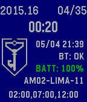
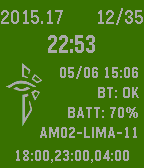

<!-- Generated by scripts/update_app_directory.py: do not edit by hand -->
[← All Pebble Developers](../developers.md)

# Timmins Technologies, LLC

*2 watchfaces · Last updated 2026-10-12 · [About these lists](../about-app-lists.md)*

Links: [Pebble App Store](https://apps.repebble.com/apps/dev/timmins-technologies-llc_531a88327e49755eab000db5) · [GitHub (PaulTimmins)](https://github.com/PaulTimmins) · [Website (timmins.net)](http://www.timmins.net/business/)

<button type="button" data-filter="all" aria-pressed="true">All 2</button><button type="button" data-filter="watchface" aria-pressed="false">Watchfaces 2</button><button type="button" data-filter="watchapp" aria-pressed="false" disabled>Apps 0</button>

<label class="dev-sort">Sort by <select><option value="updated">Recently updated</option><option value="released">Newest release</option><option value="title">A–Z</option></select></label>

<h2 class="app-name" id="app-54ae1138f66371a06700003f"><a href="https://apps.repebble.com/54ae1138f66371a06700003f">Ingress Resistance Cycle Time</a> v2.6</h2>
<a class="app-source" href="https://github.com/PaulTimmins/pebbleIngressCycleTime" title="Source code" data-search-exclude>View source</a>

Watchface

Apache-2.0 Released 2015-01-08 Updated 2015-12-24

Runs on: Time 2, Pebble 2 Duo, Pebble 2, Time, Classic

The watchface displays: * The current septicycle * The current checkpoint out of 35 * A countdown to the next checkpoint * The current time (24h format) * Bluetooth status * Watch Battery Level…

<h2 class="app-name" id="app-554a66b51c6fe71b79000073"><a href="https://apps.repebble.com/554a66b51c6fe71b79000073">Ingress Enlightened Cycle Time</a> v2.1</h2>
<a class="app-source" href="https://github.com/PaulTimmins/pebbleEnlCycleTime.git" title="Source code" data-search-exclude>View source</a>

Watchface

Apache-2.0 Released 2015-05-06 Updated 2015-05-16

Runs on: Time 2, Pebble 2 Duo, Pebble 2, Time, Classic

The watchface displays (in color!): * The current septicycle * The current checkpoint out of 35 * A countdown to the next checkpoint * The current time (24h format) * Bluetooth status * Watch…

