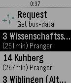

<!-- Generated by scripts/update_app_directory.py: do not edit by hand -->
[← All Pebble Developers](../developers.md)

# Timo Zuccarello

*1 app · Last updated 2026-10-12 · [About these lists](../about-app-lists.md)*

Links: [Rebble App Store](https://apps.rebble.io/en_US/developer/58e36a7a0dfc3254c6000932/1) · [GitHub (DeltaTimo)](https://github.com/DeltaTimo)

<h2 class="app-name" id="app-5939f07fb67f9fb68e000c48"><a href="https://apps.rebble.io/en_US/application/5939f07fb67f9fb68e000c48">Served! Ulm (Busses in Ulm)</a> v2.0</h2>
<a class="app-source" href="https://github.com/DeltaTimo/DINGConnections" title="Source code" data-search-exclude>View source</a>

App

No licence Released 2017-06-09 Updated 2017-09-21 Rebble App Store

Runs on: Time 2, Pebble 2 Duo, Pebble 2, Time, Classic

Now supports - German. Never miss your bus home from a party again! Served! Ulm shows you departure times of busses and trams near you queried directly from the Official DING Server. Supports only…

