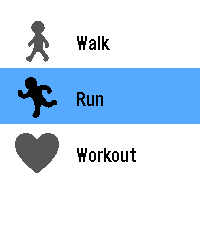

<!-- Generated by scripts/update_app_directory.py: do not edit by hand -->
[← All Pebble Developers](../developers.md)

# TimTek

*1 app · Last updated 2026-10-12 · [About these lists](../about-app-lists.md)*

Links: [Pebble App Store](https://apps.repebble.com/apps/dev/timtek_1af20955237e32fc90ab831a) · [GitHub (axisdrama)](https://github.com/axisdrama)

<h2 class="app-name" id="app-5a50a70d9120477db6e41748"><a href="https://apps.repebble.com/5a50a70d9120477db6e41748">Pebble Pacer</a> v1.3.6</h2>
<a class="app-source" href="https://github.com/axisdrama/PebblePacer/tree/main" title="Source code" data-search-exclude>View source</a>

App

MIT Released 2026-10-09 Updated 2026-10-12

Runs on: Time 2

# PebblePacer A fork of WayeM’s Allure A workout app for the **Pebble Time 2** (platform `emery`): walk, run or train with your heart rate shown live in five colour-coded effort zones. ## Features…

