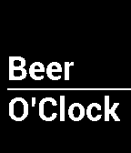

<!-- Generated by scripts/update_app_directory.py: do not edit by hand -->
[← All Pebble Developers](../developers.md)

# TJ Hunter

*2 watchfaces · Last updated 2026-10-11 · [About these lists](../about-app-lists.md)*

Links: [Pebble App Store](https://apps.repebble.com/apps/dev/tj-hunter_531a19549091c45874000005) · [GitHub (Hypnopompia)](https://github.com/Hypnopompia) · [Website (twitter.com)](https://twitter.com/hunter_tj)

<button type="button" data-filter="all" aria-pressed="true">All 2</button><button type="button" data-filter="watchface" aria-pressed="false">Watchfaces 2</button><button type="button" data-filter="watchapp" aria-pressed="false" disabled>Apps 0</button>

<label class="dev-sort">Sort by <select><option value="updated">Recently updated</option><option value="released">Newest release</option><option value="title">A–Z</option></select></label>

<h2 class="app-name" id="app-53ea6f0b9664bf4148000158"><a href="https://apps.repebble.com/53ea6f0b9664bf4148000158">Wine O&#x27;Clock</a> v1.0.0</h2>
<a class="app-source" href="https://github.com/Hypnopompia/pebble-wineOClock" title="Source code" data-search-exclude>View source</a>

Watchface

MIT Released 2014-08-12 Updated 2014-08-12

Runs on: Time 2, Pebble 2 Duo, Pebble 2, Time, Classic

A simple watch face that only shows the text &quot;Wine O&#x27;Clock&quot; and never changes.

<h2 class="app-name" id="app-531a8ed72559af6f680007ff"><a href="https://apps.repebble.com/531a8ed72559af6f680007ff">Beer O&#x27;Clock</a> v2.0.0</h2>
<a class="app-source" href="https://github.com/Hypnopompia/pebble-beerOClock" title="Source code" data-search-exclude>View source</a>

Watchface

MIT Released 2014-03-08 Updated 2014-03-08

Runs on: Time 2, Pebble 2 Duo, Pebble 2, Time, Classic

A simple watch face that only shows the text &quot;Beer O&#x27;Clock&quot; and never changes.

