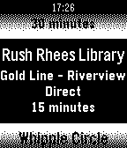
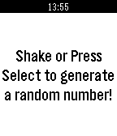

<!-- Generated by scripts/update_app_directory.py: do not edit by hand -->
[← All Pebble Developers](../developers.md)

# TJ Stein

*2 apps · Last updated 2026-10-12 · [About these lists](../about-app-lists.md)*

Links: [Pebble App Store](https://apps.repebble.com/apps/dev/tj-stein_52b91beca1d2df1269000037) · [GitHub (tstein4)](https://github.com/tstein4)

<button type="button" data-filter="all" aria-pressed="true">All 2</button><button type="button" data-filter="watchface" aria-pressed="false" disabled>Watchfaces 0</button><button type="button" data-filter="watchapp" aria-pressed="false">Apps 2</button>

<label class="dev-sort">Sort by <select><option value="updated">Recently updated</option><option value="released">Newest release</option><option value="title">A–Z</option></select></label>

<h2 class="app-name" id="app-539fc03d051716df30000187"><a href="https://apps.repebble.com/539fc03d051716df30000187">UR Buses</a> v2.3</h2>
<a class="app-source" href="https://github.com/tstein4/urbuses-pebble" title="Source code" data-search-exclude>View source</a>

App

Released 2014-06-17 Updated 2014-08-27

Runs on: Time 2, Pebble 2 Duo, Pebble 2, Time, Classic

Get real time arrival estimates on your watch for the University of Rochester bus service. Pick any 5 route and stop combinations to view on your Pebble. Changelog at urbuses.tjstein.me/changelog

<h2 class="app-name" id="app-53e34a13b52fe7649500013b"><a href="https://apps.repebble.com/53e34a13b52fe7649500013b">Random</a> v2.0</h2>
<a class="app-source" href="https://github.com/tstein4/random-pebble" title="Source code" data-search-exclude>View source</a>

App

Released 2014-08-07 Updated 2014-08-21

Runs on: Time 2, Pebble 2 Duo, Pebble 2, Time, Classic

Ever needed a bit of randomness to make a decision? Well then this is the app for you! Formerly Coin Flip, this app now has a brand new Random Number Generator in addition to the old coin flipping…

