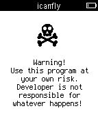

<!-- Generated by scripts/update_app_directory.py: do not edit by hand -->
[← All Pebble Developers](../developers.md)

# tmnhy

*2 apps · Last updated 2026-10-11 · [About these lists](../about-app-lists.md)*

Links: [Pebble App Store](https://apps.repebble.com/apps/dev/tmnhy_54647acdd238c5d89300001e) · [Website (forums.getpebble.com)](http://forums.getpebble.com/discussion/21446/app-device-status)

<button type="button" data-filter="all" aria-pressed="true">All 2</button><button type="button" data-filter="watchface" aria-pressed="false" disabled>Watchfaces 0</button><button type="button" data-filter="watchapp" aria-pressed="false">Apps 2</button>

<label class="dev-sort">Sort by <select><option value="updated">Recently updated</option><option value="released">Newest release</option><option value="title">A–Z</option></select></label>

<h2 class="app-name" id="app-5506e53bed40850ea3000015"><a href="https://apps.repebble.com/5506e53bed40850ea3000015">Device status</a> v1.5</h2>
<a class="app-source" href="https://bitbucket.org/tmnhy/pebble-device-status/src" title="Source code" data-search-exclude>View source</a>

App

Released 2015-03-16 Updated 2015-03-29

Runs on: Time 2, Pebble 2 Duo, Pebble 2, Time, Classic

Show 5 sec. pop-up notifications, phone connection and battery state: - battery icon, by wrist; - phone connection icon, by change state. Runs in the background and do not depend on others running…

<h2 class="app-name" id="app-54f0c7166ef0940b2b00008c"><a href="https://apps.repebble.com/54f0c7166ef0940b2b00008c">I can fly</a> v1.0</h2>
<a class="app-source" href="https://bitbucket.org/tmnhy/icanfly/src" title="Source code" data-search-exclude>View source</a>

App

Released 2015-02-27 Updated 2015-02-27

Runs on: Time 2, Pebble 2 Duo, Pebble 2, Time, Classic

Player throws his Pebble as high as he can. The higher, the better. Pebble registers the height. WARNING: Throwing a Pebble high into the air may result in both damage to the Pebble, property…

