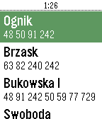

<!-- Generated by scripts/update_app_directory.py: do not edit by hand -->
[← All Pebble Developers](../developers.md)

# tmszdmsk

*1 app · Last updated 2026-10-11 · [About these lists](../about-app-lists.md)*

Links: [Pebble App Store](https://apps.repebble.com/apps/dev/tmszdmsk_56f97b953f944d658a000001) · [GitHub (tmszdmsk)](https://github.com/tmszdmsk)

<h2 class="app-name" id="app-5734fe1f0aae1f3a0f000020"><a href="https://apps.repebble.com/5734fe1f0aae1f3a0f000020">Pekkle</a> v1.2</h2>
<a class="app-source" href="https://github.com/tmszdmsk/pekkle" title="Source code" data-search-exclude>View source</a>

App

Released 2016-05-12 Updated 2016-05-19

Runs on: Round 2, Time 2, Pebble 2 Duo, Pebble 2, Time Round, Time, Classic

Poznań, Poland timetable app. Shows stops around you and fetches live data about departure times from PEKA system. tags: Poznań, Poznan, mpk, ztm, peka

