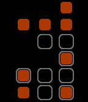

<!-- Generated by scripts/update_app_directory.py: do not edit by hand -->
[← All Pebble Developers](../developers.md)

# TMunz

*1 watchface · Last updated 2026-10-11 · [About these lists](../about-app-lists.md)*

Links: [Pebble App Store](https://apps.repebble.com/apps/dev/tmunz_55f1ddc12d148e10c8000015) · [GitHub (tmunz)](https://github.com/tmunz)

<h2 class="app-name" id="app-5637b2514096619e3e000073"><a href="https://apps.repebble.com/5637b2514096619e3e000073">Alpha Binary Clock</a> v1.1</h2>
<a class="app-source" href="https://github.com/tmunz/PebbleAlphaBinary/" title="Source code" data-search-exclude>View source</a>

Watchface

Released 2015-11-02 Updated 2015-11-02

Runs on: Time 2, Pebble 2 Duo, Pebble 2, Time, Classic

The picture above shows the watchface of the Alpha Binary Clock. The orange dots display the time, the grey borders the date. The time can be simply calculated by summing up their values, which…

