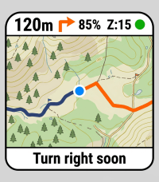
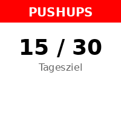
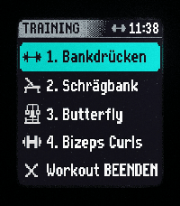

<!-- Generated by scripts/update_app_directory.py: do not edit by hand -->
[← All Pebble Developers](../developers.md)

# tob1

*3 apps · Last updated 2026-10-12 · [About these lists](../about-app-lists.md)*

Links: [Pebble App Store](https://apps.repebble.com/apps/dev/tob1_482f35c41c8881124fe8662b) · [GitHub (sirTob1)](https://github.com/sirTob1)

<button type="button" data-filter="all" aria-pressed="true">All 3</button><button type="button" data-filter="watchface" aria-pressed="false" disabled>Watchfaces 0</button><button type="button" data-filter="watchapp" aria-pressed="false">Apps 3</button>

<label class="dev-sort">Sort by <select><option value="updated">Recently updated</option><option value="released">Newest release</option><option value="title">A–Z</option></select></label>

<h2 class="app-name" id="app-4396804c939041c5a7b9edf1"><a href="https://apps.repebble.com/4396804c939041c5a7b9edf1">TopoNav</a> v3.3</h2>
<a class="app-source" href="https://github.com/sirTob1/pebble-topo-nav" title="Source code" data-search-exclude>View source</a>

App

Released 2026-06-07 Updated 2026-09-27

Runs on: Round 2, Time 2, Pebble 2 Duo, Pebble 2, Time Round, Time, Classic

TopoNav brings offline-capable topographic maps and smart turn-by-turn navigation directly to your wrist. Perfect for hikers, cyclists, geocachers, and outdoor enthusiasts, this app connects…

<h2 class="app-name" id="app-b5dd8463784242919479af00"><a href="https://apps.repebble.com/b5dd8463784242919479af00">Pushup Reminder</a> v2.3</h2>
<a class="app-source" href="https://github.com/sirTob1/pebble-pushup-reminder" title="Source code" data-search-exclude>View source</a>

App

Released 2026-06-17 Updated 2026-09-27

Runs on: Round 2, Time 2, Time Round, Time

A Vibe Coding Project: Built entirely through the magic of Vibe Coding, this app represents the perfect blend of human intuition and AI-assisted engineering to bring modern features back to our…

<h2 class="app-name" id="app-c27fee0f38424667a861e49a"><a href="https://apps.repebble.com/c27fee0f38424667a861e49a">Pebble Gym</a> v3.8</h2>
<a class="app-source" href="https://github.com/sirTob1/pebble-gym-hevy" title="Source code" data-search-exclude>View source</a>

App

Released 2026-06-07 Updated 2026-08-14

Runs on: Round 2, Time 2, Time Round, Time

Hevy Workout Routine Companion &amp; History Tracker for Pebble Smartwatches NOTE This is a Vibe-Coding project! 🎸✨ Built interactively using advanced agentic AI pair-programming to prototype, test…

