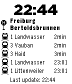

<!-- Generated by scripts/update_app_directory.py: do not edit by hand -->
[← All Pebble Developers](../developers.md)

# Tobi

*1 watchface · Last updated 2026-10-11 · [About these lists](../about-app-lists.md)*

Links: [Pebble App Store](https://apps.repebble.com/apps/dev/tobi_53b81918289beb51560001e0) · [GitHub (tobiwe)](https://github.com/tobiwe)

<h2 class="app-name" id="app-55eac1984d076dee0a00000f"><a href="https://apps.repebble.com/55eac1984d076dee0a00000f">Abfahrtsmonitor</a> v0.40</h2>
<a class="app-source" href="https://github.com/tobiwe/pebble" title="Source code" data-search-exclude>View source</a>

Watchface

Released 2015-09-05 Updated 2015-11-10

Runs on: Time 2, Pebble 2 Duo, Pebble 2, Time, Classic

Dieses Watchface zeigt dir den Abfahrtsplan deiner Haltestelle in Baden-Württemberg an. Egal ob Bus, Bahn, Zug, Tram, Straßenbahn! Es werden alle Haltestellen in Baden-Württemberg gefunden…

