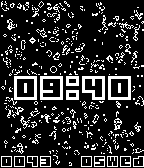

<!-- Generated by scripts/update_app_directory.py: do not edit by hand -->
[← All Pebble Developers](../developers.md)

# Tobias Westergaard Kjeldsen

*1 watchface · Last updated 2026-10-11 · [About these lists](../about-app-lists.md)*

Links: [Pebble App Store](https://apps.repebble.com/apps/dev/tobias-westergaard-kjeldsen_0ce16f163aec05f4d08f7dec) · [GitLab (tobiaswkjeldsen)](https://gitlab.com/tobiaswkjeldsen) · [Website (goledit.xyz)](https://goledit.xyz/)

<h2 class="app-name" id="app-e32338b6f4a24d72b71dcbbd"><a href="https://apps.repebble.com/e32338b6f4a24d72b71dcbbd">Game of Life</a> v2.1</h2>
<a class="app-source" href="https://gitlab.com/tobiaswkjeldsen/pebble-game-of-life" title="Source code" data-search-exclude>View source</a>

Watchface · <a href="https://forum.rebble.io/t/349" title="Discuss this app on the Rebble forum" data-search-exclude>Forum thread</a>

Released 2026-03-14 Updated 2026-03-14

Runs on: Time 2, Pebble 2 Duo, Pebble 2, Time, Classic

The Game of Life, also known as Conway&#x27;s Game of Life or simply Life, is a cellular automaton devised by the British mathematician John Horton Conway in 1970. Visit goledit.xyz to make your own…

