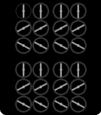
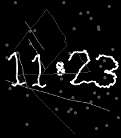
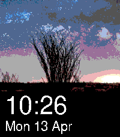
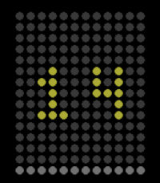

<!-- Generated by scripts/update_app_directory.py: do not edit by hand -->
[← All Pebble Developers](../developers.md)

# Tom Barrasso

*4 watchfaces · Last updated 2026-10-12 · [About these lists](../about-app-lists.md)*

Links: [Pebble App Store](https://apps.repebble.com/apps/dev/tom-barrasso_fbc733e607111c40a710b20a) · [GitHub (Tombarr)](https://github.com/Tombarr) · [Website (barrasso.me)](https://barrasso.me)

<button type="button" data-filter="all" aria-pressed="true">All 4</button><button type="button" data-filter="watchface" aria-pressed="false">Watchfaces 4</button><button type="button" data-filter="watchapp" aria-pressed="false" disabled>Apps 0</button>

<label class="dev-sort">Sort by <select><option value="updated">Recently updated</option><option value="released">Newest release</option><option value="title">A–Z</option></select></label>

<h2 class="app-name" id="app-adef02297c584fe7929b31ac"><a href="https://apps.repebble.com/adef02297c584fe7929b31ac">PebblePebble24</a> v1.1</h2>
<a class="app-source" href="https://github.com/Tombarr/PebblePebble24" title="Source code" data-search-exclude>View source</a>

Watchface

Apache-2.0 Released 2026-04-12 Updated 2026-04-16

Runs on: Round 2, Time 2, Pebble 2 Duo, Pebble 2, Time Round, Time, Classic

Animated watch face inspires by ClockClock24 from Humans Since 1982

<h2 class="app-name" id="app-6afcc59fbee742cebca541b5"><a href="https://apps.repebble.com/6afcc59fbee742cebca541b5">CAPTCHA</a> v1.0</h2>
<a class="app-source" href="https://github.com/Tombarr/pebble-captcha" title="Source code" data-search-exclude>View source</a>

Watchface

Apache-2.0 Released 2026-04-16 Updated 2026-04-16

Runs on: Round 2, Time 2, Pebble 2 Duo, Pebble 2, Time Round, Time, Classic

Old-school CAPTCHA inspired watch face

<h2 class="app-name" id="app-d99899f2c0ce41cc971e98fb"><a href="https://apps.repebble.com/d99899f2c0ce41cc971e98fb">Bing Daily</a> v1.0</h2>
<a class="app-source" href="https://github.com/Tombarr/bing-watch-face" title="Source code" data-search-exclude>View source</a>

Watchface

Apache-2.0 Released 2026-04-13 Updated 2026-04-13

Runs on: Round 2, Time 2, Pebble 2 Duo, Pebble 2, Time Round, Time, Classic

Bing daily wallpaper watch face

<h2 class="app-name" id="app-36e32a26a469451d97322d8d"><a href="https://apps.repebble.com/36e32a26a469451d97322d8d">Less is More</a> v1.1</h2>
<a class="app-source" href="https://github.com/Tombarr/less-is-more" title="Source code" data-search-exclude>View source</a>

Watchface

Apache-2.0 Released 2026-04-04 Updated 2026-04-06

Runs on: Round 2, Time 2, Pebble 2 Duo, Pebble 2, Time Round, Time, Classic

Dieter Rams&#x27; Braun Less-is-More inspired watchface

