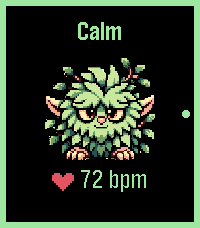

<!-- Generated by scripts/update_app_directory.py: do not edit by hand -->
[← All Pebble Developers](../developers.md)

# Tom Cassady

*1 app · Last updated 2026-11-09 · [About these lists](../about-app-lists.md)*

Links: [Pebble App Store](https://apps.repebble.com/apps/dev/tom-cassady_5629c2345dfacd9d3d5a11ac) · [GitHub (SoapyD)](https://github.com/SoapyD)

<h2 class="app-name" id="app-6984ff43a8944f5c9a6857bc"><a href="https://apps.repebble.com/6984ff43a8944f5c9a6857bc">BPMonster</a> v0.5.0</h2>
<a class="app-source" href="https://github.com/SoapyD/PebbleStress" title="Source code" data-search-exclude>View source</a>

App

No licence Released 2026-10-30 Updated 2026-11-08

Runs on: Round 2, Time 2

A monster that reacts to your heart rate. A little monster lives on your watch and reacts to your heart rate. Set two levels on your phone, and it tells you when your heart rate climbs past them…

