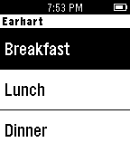

<!-- Generated by scripts/update_app_directory.py: do not edit by hand -->
[← All Pebble Developers](../developers.md)

# Tom Fanella

*1 app · Last updated 2026-10-11 · [About these lists](../about-app-lists.md)*

Links: [Pebble App Store](https://apps.repebble.com/apps/dev/tom-fanella_549c8720dc93036df4000835) · [GitHub (TomFanella4)](https://github.com/TomFanella4)

<h2 class="app-name" id="app-56099b37364a068199000091"><a href="https://apps.repebble.com/56099b37364a068199000091">Purdue Menu</a> v1.0</h2>
<a class="app-source" href="https://github.com/TomFanella4/Purdue-Menu" title="Source code" data-search-exclude>View source</a>

App

No licence Released 2015-09-28 Updated 2015-09-29

Runs on: Time 2, Pebble 2 Duo, Pebble 2, Time, Classic

View the entire Purdue Dining Court menu right on your Pebble! - View the menu for all 5 of Purdue&#x27;s Dining Courts - Displays &quot;(NS)&quot; when the dining court is not serving at that time Email me if…

