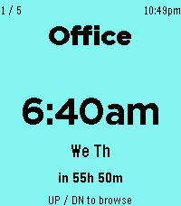
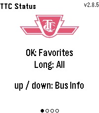

<!-- Generated by scripts/update_app_directory.py: do not edit by hand -->
[← All Pebble Developers](../developers.md)

# Tom Khamis

*4 apps · Last updated 2026-10-12 · [About these lists](../about-app-lists.md)*

Links: [Pebble App Store](https://apps.repebble.com/apps/dev/tom-khamis_221fb95fe8d07190aa28efe3) · [GitHub (ttkhamis)](https://github.com/ttkhamis)

<button type="button" data-filter="all" aria-pressed="true">All 4</button><button type="button" data-filter="watchface" aria-pressed="false" disabled>Watchfaces 0</button><button type="button" data-filter="watchapp" aria-pressed="false">Apps 4</button>

<label class="dev-sort">Sort by <select><option value="updated">Recently updated</option><option value="released">Newest release</option><option value="title">A–Z</option></select></label>

<h2 class="app-name" id="app-7bff2f5004fa47e094b8c32d"><a href="https://apps.repebble.com/7bff2f5004fa47e094b8c32d">Ripple Alarm</a> v1.2.40</h2>
<a class="app-source" href="https://github.com/ttkhamis/pebble_alarm" title="Source code" data-search-exclude>View source</a>

App

Released 2026-06-01 Updated 2026-09-15

Runs on: Time 2

A large-text alarm clock designed to be easy to read at a glance. Set up to 5 alarms from your phone — each with its own label, color, and weekly schedule.

<h2 class="app-name" id="app-81ae848ad40a48f4903cd40f"><a href="https://apps.repebble.com/81ae848ad40a48f4903cd40f">Nothing Battery</a> v1.0.5</h2>
<a class="app-source" href="https://github.com/ttkhamis/Pebble_Battery" title="Source code" data-search-exclude>View source</a>

App

Released 2026-06-04 Updated 2026-08-06

Runs on: Time 2, Pebble 2 Duo, Pebble 2, Time, Classic

Pebble Battery is a clean, glanceable battery app inspired by the Nothing Phone widget aesthetic. The main screen fills the display with a bold dot grid, purple on dark, red on light, where each…

<h2 class="app-name" id="app-79b07c1b90df42e6a39e2458"><a href="https://apps.repebble.com/79b07c1b90df42e6a39e2458">TTC Subway &amp; Bus</a> v3.0.3</h2>
<a class="app-source" href="https://github.com/ttkhamis/Pebble_TTC_Info" title="Source code" data-search-exclude>View source</a>

App

Released 2026-06-12 Updated 2026-07-24

Runs on: Time 2

TTC Subway &amp; Bus — Toronto transit at a glance, right on your wrist. Get real-time bus and streetcar arrivals for up to 5 saved locations (4 routes each), with countdowns that keep ticking between…

<h2 class="app-name" id="app-abf0a3fa4b7044308388f53d"><a href="https://apps.repebble.com/abf0a3fa4b7044308388f53d">Homey Flows</a> v1.3.0</h2>
<a class="app-source" href="https://github.com/ttkhamis/homey-flow-trigger" title="Source code" data-search-exclude>View source</a>

App

Released 2026-05-28 Updated 2026-06-07

Runs on: Time 2

Trigger your Homey flows directly from your Pebble Time 2, no phone needed once configured. Browse up to 5 customizable flow shortcuts on your wrist and fire them instantly with a single button…

