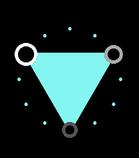

<!-- Generated by scripts/update_app_directory.py: do not edit by hand -->
[← All Pebble Developers](../developers.md)

# Tom Medley

*2 watchfaces · Last updated 2026-10-12 · [About these lists](../about-app-lists.md)*

Links: [Pebble App Store](https://apps.repebble.com/apps/dev/tom-medley_53206910deec0c9bdd0001ab) · [GitHub (fredley)](https://github.com/fredley) · [Website (mamota.net)](https://mamota.net)

<button type="button" data-filter="all" aria-pressed="true">All 2</button><button type="button" data-filter="watchface" aria-pressed="false">Watchfaces 2</button><button type="button" data-filter="watchapp" aria-pressed="false" disabled>Apps 0</button>

<label class="dev-sort">Sort by <select><option value="updated">Recently updated</option><option value="released">Newest release</option><option value="title">A–Z</option></select></label>

<h2 class="app-name" id="app-559be5f63eff7a601800003e"><a href="https://apps.repebble.com/559be5f63eff7a601800003e">3ANGLE</a> v2.0.1</h2>
<a class="app-source" href="https://github.com/fredley/3ANGLE" title="Source code" data-search-exclude>View source</a>

Watchface

No licence Released 2015-07-07 Updated 2026-06-04

Runs on: Round 2, Time 2, Pebble 2 Duo, Pebble 2, Time Round, Time, Classic

3Angle displays the time using a triangle connecting the hour, minute and second. A unique and stylish way to show off your Pebble! Inspired by a design by Rasam Rostami on Behance.

<h2 class="app-name" id="app-5548f8342cfbfc5df400007b"><a href="https://apps.repebble.com/5548f8342cfbfc5df400007b">Color Fuzzy Time</a> v1.2</h2>
<a class="app-source" href="https://github.com/fredley/Fuzzy-Colour" title="Source code" data-search-exclude>View source</a>

Watchface

No licence Released 2015-05-05 Updated 2015-05-07

Runs on: Time 2, Time

Color Fuzzy Time displays the time imprecisely using words, in glorious color. A minimalist clockface with only an hour hand is also shown, and the color is picked according to the temperature…

